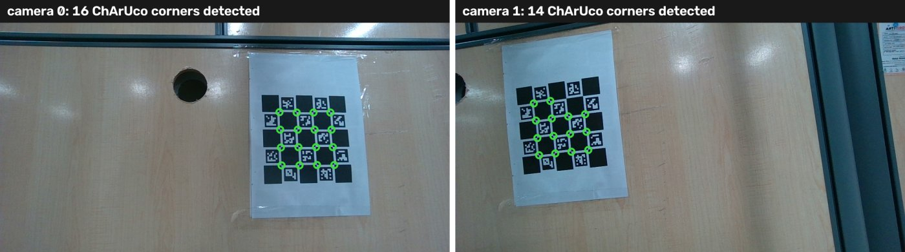
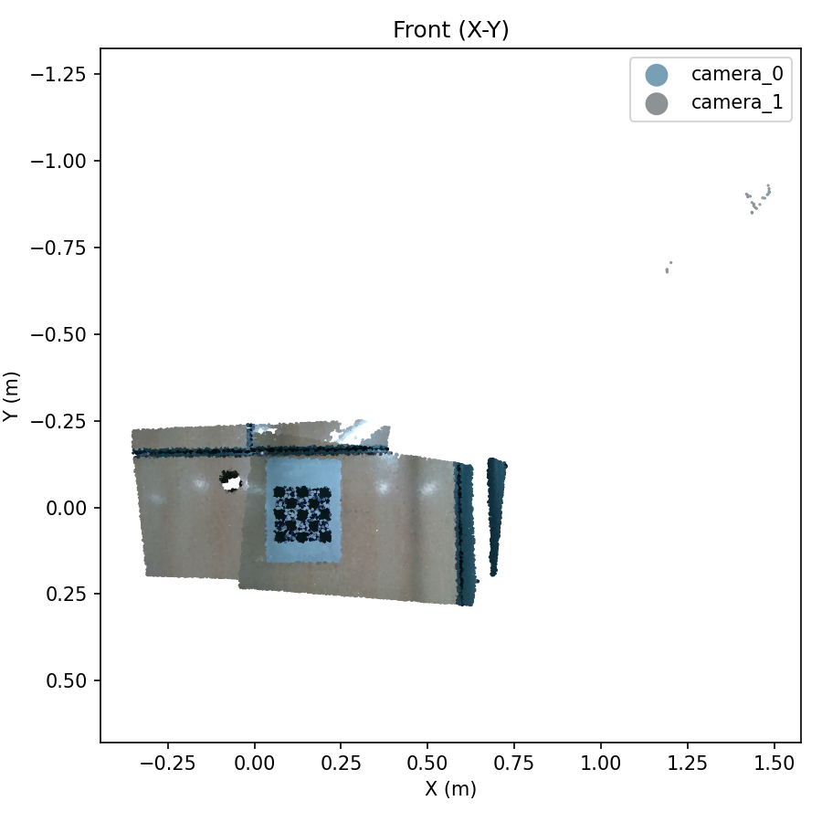
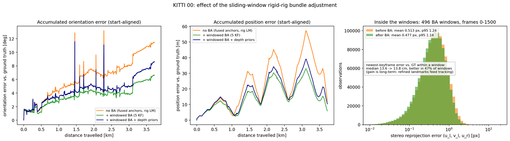
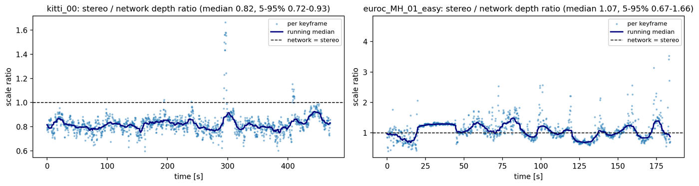

# MetricVision
Feature extractors for visual odometry, measured end to end

Benchmark visual odometry front ends (feature extraction + matching) inside one
fixed stereo VO back end, so trajectory differences come from the extractor and
nothing else.
 
Status (mid submission, Oct 2026): two stereo VO pipelines sharing one evaluation path:

- **Sparse pipeline** (`pipeline: sparse`): FAST + ORB stereo matching along epipolar lines,
  triangulation with first-order depth covariance, KLT tracking with a circular L/R check
  (3D-2D correspondences per frame), PnP + RANSAC initial pose, and a covariance-weighted
  **rigid-rig Levenberg-Marquardt** refinement with analytic Jacobians (left + right residuals).
- **Dense pipeline** (`pipeline: dense`): pairwise ORB/SIFT matching against keyframes,
  fixed SGBM stereo depth, PnP + RANSAC, with the same LM available as refinement.

Evaluated with evo (ATE/RPE) and a port of the KITTI devkit (t_rel, r_rel) on KITTI 00,
EuRoC MH_01 and a built-in synthetic sequence for smoke testing.
A sliding-window rigid-rig bundle adjustment and RoMeO-style monocular depth priors are available as a
proof of concept (see [below](#windowed-ba-and-monocular-depth-priors-poc)).
Learned front ends (SuperPoint+LightGlue, ALIKED+LightGlue, MASt3R) and dynamic-object handling are
benchmarked [below](#learned-front-ends-superpoint-aliked-mast3r); the ROS 2 node comes next.

## Highlights


*KITTI 00 (3.7 km, no loop closure). The sparse stereo pipeline with sliding-window bundle adjustment
(green) stays closer to the ground truth than the same pipeline without BA (orange).*

| KITTI 00 + EuRoC MH_01 (full sequences, 0 tracking failures) | KITTI ATE | KITTI t_rel | KITTI r_rel | EuRoC ATE |
|---|---|---|---|---|
| Dense ORB + SGBM stereo depth (baseline) | 8.97 m | 1.73% | 0.79°/100 m | 13.7 cm |
| Sparse FAST/ORB/KLT, fused anchors, rig LM | 10.38 m | 1.39% | 0.50°/100 m | 5.2 cm |
| **+ sliding-window BA (5 keyframes)** | **6.33 m** | **1.18%** | **0.39°/100 m** | **5.1 cm** |
| + BA + gated monocular depth priors | 7.51 m | 1.33% | 0.45°/100 m | 6.5 cm |
| Monocular metric VO (left image + Depth Anything V2) | 116.5 m | 12.6% | 3.36°/100 m | 216.6 cm |

t_rel and r_rel are the official KITTI devkit drift metrics (100-800 m segments); ATE is after SE(3) alignment, without scale.

**The front end.** FAST corners with ORB descriptors are matched only along epipolar lines, refined to
sub-pixel disparity and triangulated with a first-order depth covariance:


Features are tracked frame to frame with KLT around the circle left(t-1) -> left(t) -> right(t) -> right(t-1).
A track survives only if the circle closes within 1 px, which rejects repetitive texture and moving objects (red):


## Hardware: the wheelchair rig

Two Intel RealSense colour cameras (1280×720) are mounted rigidly on a powered wheelchair, about 0.42 m apart,
which is a stereo baseline comparable to KITTI's 0.54 m. The rig is recorded with ROS 2.

<p align="center"><br>
<em>The wheelchair platform: an aluminium mast with 3D-printed mounts, with ChArUco calibration boards on the lab partitions behind.</em></p>

**Stereo calibration.** The extrinsic is calibrated with [MC-Calib](https://github.com/rameau-fr/MC-Calib)
from a ChArUco board (5×5, 3.2 cm squares) seen by both cameras, with the RealSense factory intrinsics held fixed.
Over 245 synchronised frames and 7,558 detected corners, the reprojection error is **0.27 px mean**
(0.32 px RMS, 0.23 px median), under the proposal's 0.5 px target. The calibrated extrinsic is then frozen:
it is the fixed baseline the rigid-rig LM and the windowed BA rely on.



**First 3D data from our own recording.** Both cameras' depth, fused into one frame with the calibrated
extrinsic: 687,980 points from a ROS 2 bag. The wall panel, the ChArUco board and the hole in the panel are all
recovered in 3D, and the two cameras' clouds line up.

<p align="center"></p>

Next: record full wheelchair sequences, run the stereo VO on them, and compare against wheel odometry.
 
## Project layout
 
```
metricvision/
├── pyproject.toml            # Dependencies and tool settings (uv, ruff, mypy, pytest)
├── uv.lock                   # Exact dependency versions, shared by laptop and Jetson
├── .python-version           # Python 3.10 (ROS 2 Humble and JetPack 6 both use it)
├── .devcontainer/
│   ├── laptop/               # x86_64 + CUDA image
│   └── jetson/               # Jetson AGX Orin (L4T / JetPack 6) image
├── configs/                  # One YAML per dataset
├── src/metricvision/
│   ├── core/                 # Data types, SE(3) helpers (exp map), stereo triangulation + covariance, registry
│   ├── datasets/             # StereoDataset ABC + EuRoC, KITTI, synthetic loaders
│   ├── frontend/             # FeatureMatcher ABC + ORB, SIFT; StereoFrontend ABC + FAST/ORB/KLT  <- variable under test
│   ├── depth/                # DepthEstimator ABC + SGBM (dense pipeline only)
│   ├── backend/              # PnP + RANSAC, rigid-rig LM (lm.py), keyframe VO, frame-to-frame sparse VO
│   ├── evaluation/           # Front-end metrics, ATE/RPE via evo, KITTI devkit metric, output writers
│   ├── config.py             # YAML -> typed config
│   ├── pipeline.py           # Runs one (sequence, front end) experiment
│   └── cli.py                # `metricvision run` / `metricvision list`
├── scripts/                  # run_experiments.sh (full matrix), make_report_assets.py (tables + figures)
├── docs/                     # Mid report (Markdown + LaTeX), generated tables and figures
└── tests/                    # Unit + end-to-end tests (no downloads needed)
```
 
## Setup
 
### Option A: uv directly on the host
 
```bash
curl -LsSf https://astral.sh/uv/install.sh | sh   # Install uv once
uv sync --all-groups                              # Create .venv from uv.lock
uv run pytest                                     # Verify: all tests should pass
```
 
### Option B: laptop dev container
 
Prerequisites: Docker, the NVIDIA Container Toolkit, an NVIDIA driver ≥ 550,
and VS Code with the Dev Containers extension.
 
1. Put datasets under `~/datasets` on the host. It is mounted at `/data`.
2. Run **Dev Containers: Reopen in Container** and choose **metricvision (laptop, CUDA)**.
3. The container runs `uv sync --all-groups` on creation. Check with
   `metricvision run configs/synthetic.yaml`.
   
### Option C: Jetson dev container
 
1. On the Jetson, run `cat /etc/nv_tegra_release`. Set `L4T_TAG` in
   `.devcontainer/jetson/devcontainer.json` to match (e.g. `R36 … REVISION: 4.0` → `r36.4.0`).
2. From the laptop, use **Remote-SSH** to connect to the Jetson and open the cloned repo.
3. Run **Reopen in Container** and choose **metricvision (Jetson AGX)**.
4. Run the synthetic smoke test. It exercises the entire pipeline without any data.
Both images use Ubuntu 22.04 with its system Python 3.10 and the same
`uv.lock`, so the environment is identical on both machines. Adding ROS 2
Humble's `rclpy` later works because it is built for that same Python.
 
## Datasets
 
```
~/datasets/euroc/MH_01_easy/mav0/...     # ASL format zip from the EuRoC page, extracted
~/datasets/kitti/sequences/00/...        # KITTI odometry grayscale + calibration
~/datasets/kitti/poses/00.txt            # KITTI ground truth (sequences 00-10)
```
 
EuRoC images are distorted, so the loader rectifies them with the calibration
in each `sensor.yaml`. EuRoC ground truth describes the IMU body frame. The
pipeline therefore converts camera poses to the body frame before evaluating
and writing trajectories. KITTI images are already rectified, and its ground
truth is in the left camera frame.
 
## Running experiments
 
```bash
metricvision list                                              # Show available components
metricvision run configs/synthetic.yaml                        # Smoke test, no download
metricvision run configs/euroc.yaml --dataset-root /data/euroc/MH_01_easy
metricvision run configs/euroc.yaml --dataset-root /data/euroc/MH_01_easy --matcher sift
metricvision run configs/kitti.yaml --dataset-root /data/kitti --max-frames 500
metricvision run configs/kitti.yaml --dataset-root /data/kitti --pipeline sparse --refine lm --run-name sparse_lm
```

`--pipeline {dense,sparse}` picks the VO pipeline, `--refine {none,opencv,lm}` the pose
refinement after PnP + RANSAC, and `--run-name` the output folder (use it for ablations so
runs don't overwrite each other). The full mid-submission matrix (6 runs per sequence) and
the report tables/figures are produced by:

```bash
KITTI_ROOT=/data/kitti EUROC_ROOT=/data/euroc/MH_01_easy JOBS=3 scripts/run_experiments.sh
```
 
Outside a container, prefix commands with `uv run`. `--matcher` keeps the
shared parameters (`max_keypoints`, `ratio`, `mutual_check`), so the keypoint
budget stays equal when you switch extractors.
 
Each run writes to `results/<sequence>/<run name>/` (the run name defaults to the front-end name):
 
| File | Contents |
|---|---|
| `summary.json` | ATE/RPE, tracking failures, mean matches, inlier ratio, runtimes, FPS |
| `frame_stats.csv` | Per-frame matches, inliers, flags and timings (for plots) |
| `trajectory.tum` | Body-frame trajectory, TUM format |
| `trajectory.kitti` | Same trajectory, KITTI format |
 
To plot with evo (use `--save_plot out.pdf` inside containers without a display):
 
```bash
evo_ape euroc /data/euroc/MH_01_easy/mav0/state_groundtruth_estimate0/data.csv \
    results/euroc_MH_01_easy/orb/trajectory.tum --align --plot --plot_mode xy
evo_ape kitti /data/kitti/poses/00.txt results/kitti_00/orb/trajectory.kitti --align --plot --plot_mode xz
```
 
## Reproducing the mid-submission results

Every number and figure in [docs/mid_report.pdf](docs/mid_report.pdf) comes from the commands
below (run from the repository root). On the host, prefix `uv run ...` with `env -u PYTHONPATH`
if ROS 2 is sourced in your shell.

**1. Data (single sequences only, via HTTP range requests):**

```bash
uv run --with remotezip python scripts/download_datasets.py kitti --sequence 00 --out ~/datasets/kitti
uv run --with remotezip python scripts/download_datasets.py euroc --sequence MH_01_easy --out ~/datasets/euroc
```

Any KITTI sequence `00`-`21` (ground truth for `00`-`10`) or EuRoC scene (`MH_0x_*`, `V1_0x_*`,
`V2_0x_*`) works the same way; add `--dry-run` to see the download size first.

**2. Full experiment matrix (18 runs) and report tables/figures:**

```bash
KITTI_ROOT=~/datasets/kitti EUROC_ROOT=~/datasets/euroc/MH_01_easy JOBS=2 scripts/run_experiments.sh
uv run python scripts/make_qualitative_figures.py --out docs/figures \
    --config configs/kitti.yaml:$HOME/datasets/kitti:300 \
    --config configs/euroc.yaml:$HOME/datasets/euroc/MH_01_easy:1200
cd docs && tectonic mid_report.tex     # or: latexmk -pdf mid_report.tex
```

`run_experiments.sh` writes `results/<sequence>/<run>/` and regenerates `docs/tables/*` and
`docs/figures/*` (trajectories, devkit error vs. length, APE vs. distance, runtime, per-frame).

**3. One run on one scene** (the proposed configuration is the default in the configs:
sparse pipeline needs `--pipeline sparse`; `--anchor fused --refine lm` are already the YAML defaults):

```bash
# KITTI sequence 05, proposed method
uv run metricvision run configs/kitti.yaml --dataset-root ~/datasets/kitti --sequence 05 \
    --pipeline sparse --run-name sparse_fused_lm
# EuRoC V1_02_medium (the scene is chosen by its folder)
uv run metricvision run configs/euroc.yaml --dataset-root ~/datasets/euroc/V1_02_medium \
    --pipeline sparse --run-name sparse_fused_lm
# Any row of the results table: pick the pipeline, front end, anchoring and refinement
uv run metricvision run configs/kitti.yaml --dataset-root ~/datasets/kitti \
    --pipeline dense --matcher sift --refine lm --run-name dense_sift_lm
uv run metricvision run configs/kitti.yaml --dataset-root ~/datasets/kitti \
    --pipeline sparse --anchor previous --refine opencv --run-name sparse_f2f_opencv
# Quick check on the first 500 frames
uv run metricvision run configs/kitti.yaml --dataset-root ~/datasets/kitti --max-frames 500 --pipeline sparse
```

| Table row | Flags |
|---|---|
| Dense ORB+SGBM, OpenCV-LM | `--pipeline dense --matcher orb --refine opencv` |
| Dense ORB/SIFT+SGBM, our LM | `--pipeline dense --matcher orb\|sift --refine lm` |
| Sparse f2f, PnP only / OpenCV-LM / rig-LM | `--pipeline sparse --anchor previous --refine none\|opencv\|lm` |
| Sparse birth anchors, rig-LM | `--pipeline sparse --anchor birth --refine lm` |
| Sparse fused anchors, OpenCV-LM / rig-LM (proposed) | `--pipeline sparse --anchor fused --refine opencv\|lm` |

Each run prints its summary and writes `summary.json` (ATE/RPE, failures, timings),
`frame_stats.csv`, `trajectory.tum` and `trajectory.kitti` to `results/<sequence>/<run name>/`.
For the KITTI devkit metric of a single run:

```bash
uv run python -c "from pathlib import Path; from metricvision.evaluation.kitti_metrics import *; \
print(kitti_segment_errors(load_kitti_poses(Path('results/kitti_05/sparse_fused_lm/trajectory.kitti')), \
load_kitti_poses(Path.home() / 'datasets/kitti/poses/05.txt')))"
```

and for plots of a single run, the evo commands in "Running experiments" above.

## Windowed BA and monocular depth priors (POC)

`--window 5` adds a sliding-window rigid-rig bundle adjustment to the sparse pipeline;
`--depth-prior` adds RoMeO-style gated monocular depth priors (Depth Anything V2) to it;
`--pipeline dense --depth depth_anything_v2` runs a left-camera-only monocular metric VO.
The network parts need `uv sync --extra learned` (PyTorch + transformers, < 250 MiB VRAM).
Results, figures and commands: [docs/poc/README.md](docs/poc/README.md) (local; `docs/` is not tracked),
figures regenerated by `scripts/make_poc_figures.py`.

**Bundle adjustment slows drift accumulation.** Orientation and position error against ground truth
from a common start (no alignment fitted), with and without the window BA:



Within a single window BA barely changes keyframe accuracy (it improves in 47% of 496 windows), but it lowers
reprojection error and its refined landmarks feed back into tracking, so drift over the whole sequence drops by 39%.

**Why monocular metric depth needs gating.** Depth Anything V2's metric scale is off, here about 22% too deep:


and its scale relative to stereo drifts from keyframe to keyframe (steady 0.82 bias on KITTI, 0.67-1.66 on EuRoC):



So each keyframe's network depth is first aligned to the stereo scale. A prior is then kept only for weakly
triangulated landmarks where it agrees with stereo (green). Precise stereo landmarks need none (grey),
and inconsistent priors are rejected (red):


On a 0.54 m baseline the priors don't yet beat BA alone (7.5 vs 6.3 m ATE). They should matter more where
stereo is weak: low texture, distant scenes, or a short baseline.

## Learned front ends: SuperPoint, ALIKED, MASt3R

Three learned front ends plug into the same pairwise `FeatureMatcher` interface as ORB and SIFT. They run under
the identical dense back end (keyframe matching, SGBM depth, PnP + our LM, same thresholds), at native image
resolution with the same 2000-keypoint budget:

| `--matcher` | Method | Notes |
|---|---|---|
| `superpoint_lightglue` | SuperPoint + LightGlue (official cvg/LightGlue) | ~0.4 GB VRAM; weights download on first use |
| `aliked_lightglue` | ALIKED + LightGlue | ~0.8 GB VRAM |
| `mast3r` | MASt3R dense matcher (2D matches only, never its 3D output) | ~2.8 GB VRAM, ~6 GB host RAM while loading; non-commercial licence |

```bash
uv sync --all-groups --extra learned
# MASt3R only: clone the research code and fetch the checkpoint (~2.75 GB)
git clone --recursive https://github.com/naver/mast3r.git third_party/mast3r
D=third_party/mast3r/checkpoints/MASt3R_ViTLarge_BaseDecoder_512_catmlpdpt_metric; mkdir -p $D
B=https://huggingface.co/naver/MASt3R_ViTLarge_BaseDecoder_512_catmlpdpt_metric/resolve/main
curl -L -o $D/config.json $B/config.json && curl -L -C - -o $D/model.safetensors $B/model.safetensors
# Run any of them
uv run metricvision run configs/kitti.yaml --dataset-root ~/datasets/kitti --pipeline dense --matcher aliked_lightglue --refine lm --run-name dense_aliked_lg_lm
```

**The same KITTI pair, matched by every front end** (green: consistent with one essential matrix at 1 px; red: outliers):

<p align="center"></p>

**Full-sequence results under one back end** (KITTI 00, 4541 frames; EuRoC MH_01, 3682 frames; 0 tracking failures in every run):


| Front end (dense pipeline, our LM) | KITTI t_rel | KITTI r_rel | KITTI RPE | Inliers | ms/frame | EuRoC ATE |
|---|---|---|---|---|---|---|
| ORB | 1.73% | 0.79°/100 m | 4.9 cm | 252 | 49 | 13.7 cm |
| SIFT | 1.41% | 0.52°/100 m | 2.9 cm | 325 | 83 | 4.9 cm |
| SuperPoint + LightGlue | 1.80% | 0.66°/100 m | 3.2 cm | 493 | 233 | 7.1 cm |
| ALIKED + LightGlue | 1.62% | 0.58°/100 m | 2.9 cm | 502 | 204 | 10.9 cm |
| MASt3R | 2.22% | 0.91°/100 m | 3.3 cm | 367 | 249 | 13.5 cm |
| *Sparse FAST/ORB/KLT + windowed BA (ours)* | **1.18%** | **0.39°/100 m** | 3.5 cm | 526 | 137 | 5.1 cm |

What this shows:
* **More matches do not mean less drift.** The LightGlue front ends find about 2x ORB's inliers and lower per-frame
  error, but their long-range drift is no better than SIFT's. In a fixed metric back end, drift is set by depth
  quality and pose estimation as much as by matching.
* **MASt3R is robust but imprecise here.** It matches a 512x160 version of the image, so each match is only
  accurate to about ±1.2 px at KITTI's native resolution, and its drift is the highest. Its strength is coverage:
  it matches textureless road and sky that keypoint detectors ignore.
* The learned front ends are 4-5x slower than ORB on a laptop RTX 3060 (timings measured with two runs in parallel).
  The sparse pipeline with windowed BA remains the most accurate configuration.

## Dynamic scenes: moving objects and occlusions

Two complementary, optional layers handle moving objects and occlusions:

* **Geometric gate** (`--dynamic-gate`, sparse pipeline, no network). Before a new stereo observation is fused
  into a track's landmark, a 3σ Mahalanobis test checks it against the landmark's covariance. Points on moving
  objects, or tracks that jumped onto an occluder, fail and are dropped. It is class-agnostic and free.
* **Semantic mask** (`--dynamic-mask`, both pipelines). SegFormer-B0 trained on Cityscapes (~170 MiB VRAM, ~14 ms)
  masks people, riders, cars, trucks, buses and bikes. No features are detected or tracked there, and matches
  landing on them are dropped.

Evaluated on KITTI 00 and on **KITTI 07** (busy streets and intersections):


| | KITTI 00 ATE | KITTI 07 ATE | KITTI 07 t_rel | Removed per frame |
|---|---|---|---|---|
| Dense ORB | 8.97 m | 4.60 m | 2.40% | – |
| Dense ORB + semantic mask | 22.16 m | 5.99 m | 2.74% | ~150 matches |
| Sparse + windowed BA | 6.33 m | 2.53 m | 1.35% | – |
| + geometric gate | 6.76 m | 2.52 m | 1.36% | ~3 tracks |
| + semantic mask | 6.26 m | 2.69 m | 1.42% | ~3.5 tracks |
| + gate + mask | 6.25 m | 2.60 m | 1.40% | ~6 tracks |

What this shows:
* **On KITTI, class-based masking hurts.** Most cars are parked: they are close, textured and static, which makes
  them some of the best metric features. Masking them removes ~150 matches per frame from the dense pipeline,
  and drift rises.
* **The sparse pipeline already rejects movers.** Its circular L/R check, RANSAC and the LM's χ² test remove almost
  everything that moves, so the gate and the mask find only 3-6 more tracks per frame. The changes stay within
  about ±0.4 m.
* A fair test needs genuinely dynamic sequences: dense traffic, crowds, or synthetic data with moving objects such
  as Virtual KITTI 2. KITTI 07's moving vehicles are a small fraction of its features.

## Design decisions
 
**The front end is pairwise.** `FeatureMatcher.match(view_a, view_b)` returns
2D-2D correspondences. Sparse methods implement it through
`SparseFeatureMatcher`, which caches each image's features by frame id, so a
keyframe is processed once. Dense matchers such as MASt3R have no persistent
keypoints and will implement `match` directly. Both plug into the same back end.
 
**Depth comes from fixed SGBM.** The extractor only affects keyframe-to-frame
matching and is never used for stereo matching. So each extractor is measured
in exactly one place.
 
**Tracking failure is defined explicitly.** A failure is PnP with fewer than
`pnp.min_inliers` inliers. On failure, the pose coasts on a constant-velocity
prediction, the frame becomes a new keyframe, and the failure is counted. A
pose is written for every frame, so KITTI-format files always align with
ground truth line by line.
 
**Runtime is measured honestly.** Front-end, pose and depth times are recorded
separately. `FeatureMatcher.synchronize()` is called before stopping the
front-end timer, and GPU matchers must override it with
`torch.cuda.synchronize()`. The essential-matrix inlier ratio is computed
after the timer stops, because it is a measurement, not part of the pipeline.
 
**Inlier ratio is front-end-only.** It comes from 2D-2D essential-matrix
RANSAC on the raw matches, independent of depth and PnP. It is optimistic
when the camera barely moves, so read it together with the trajectory error.
 
**Loop closure is deliberately absent,** so front-end drift stays visible.
 
**Keep these equal across extractors for fairness:** image resolution,
`max_keypoints`, ratio test settings, every `pnp.*` and `keyframe.*`
threshold, and the SGBM settings.
 
**The sparse pipeline tracks 2D features frame to frame, but anchors 3D points per track.** Each stereo pair is tracked
prev-left -> cur-left -> cur-right -> prev-right with KLT and kept only if the circle
closes within `circular_tolerance_px` and the new pair satisfies the epipolar constraint.
KLT is seeded by projecting the triangulated points with the constant-velocity prediction.
Only LM inliers stay tracked; FAST/ORB stereo detection tops up the grid when tracks fall
below `replenish_fraction * max_features` (these frames are counted as "keyframes").
`odometry.sparse_point_anchor` (or `--anchor`) selects the 3D points PnP/LM use:
`previous` re-triangulates in the previous frame (pure frame-to-frame, accumulates small biases),
`birth` keeps each track's first world-frame point, and `fused` (default) fuses every new stereo
triangulation into it by inverse covariance, so far points sharpen as they are re-observed.

**The LM is the rigid-rig estimator.** `backend/lm.py` minimises Huber-robustified,
covariance-whitened stereo reprojection error `(u_l, v_l, u_r)` over a left-multiplied
SE(3) update, with analytic Jacobians `[I | -[p]x]` and the pinhole projection Jacobian
(the right row `v_r` is left out: in a rectified rig it carries no depth and only imports rectification error).
Each residual is whitened by `J_X Sigma_X J_X^T + sigma^2 I`, where `Sigma_X` is the
triangulation covariance, so distant points (sigma_Z ~ Z^2) are down-weighted. The tests
check the Jacobians against finite differences and the covariance against Monte Carlo.
 
## Checks
 
If ROS 2 is sourced in your shell, prefix these with `env -u PYTHONPATH` (ROS's pytest plugins leak into the venv otherwise).

```bash
uv run pytest            # Unit tests (Jacobians, covariance, devkit) + end-to-end synthetic runs of both pipelines
uv run ruff check src tests
uv run ruff format --check src tests
uv run mypy src
```
