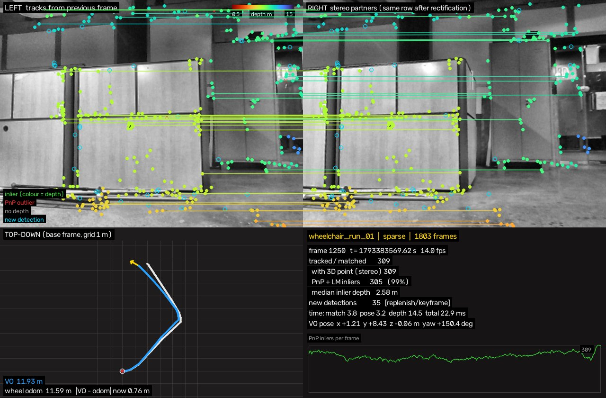

# MetricVision: stereo VO on the wheelchair, real time and simulation

Stereo visual odometry for the wheelchair's two RealSense cameras: **live** as a ROS 2 (Humble) package (part 1)
and **offline** on recorded bags and public datasets (part 2). Both compare two approaches on the same frames, with
the same rigid-rig back end (the two cameras are one rigid
body: joint left+right reprojection LM and a sliding-window rigid-rig bundle adjustment):

| Approach | Front end | Runs on |
|---|---|---|
| **classical** | FAST + ORB stereo matching, KLT tracking with a left/right circular check | CPU |
| **learned** | SuperPoint keypoints + LightGlue matching, filtered by the rig's epipolar geometry, KLT sub-pixel refinement | GPU |

References: live, DLIO lidar-inertial odometry (`/Odometry`) when it publishes, else wheel odometry (`/odom`);
offline, KITTI/EuRoC ground truth and wheel `/odom` for the bags.



## Setup (dev container)

Needs Docker, the NVIDIA Container Toolkit and an NVIDIA driver ≥ 550 on the laptop; ROS is not needed on the host.

1. Data for part 2: wheelchair bags in `ros_bags/<name>/` (`metadata.yaml` + `.db3`); KITTI odometry in
   `~/datasets/kitti/`, EuRoC in `~/datasets/euroc/<sequence>/` (`uv run --with remotezip python
   scripts/download_datasets.py kitti --sequence 00 --out ~/datasets/kitti`). `~/datasets` appears as `/data` in
   the container.
2. Open the repository in VS Code → **Dev Containers: Reopen in Container**. The first build installs CUDA,
   ROS 2 Humble, rviz2 and uv, creates the Python environment (`uv sync --all-extras`) and builds the ROS package.
3. Every container terminal has ROS and the package sourced. The ROS domain defaults to `7` (the wheelchair's);
   override with `ROS_DOMAIN_ID` on the host before opening the container.

Part 1 needs both cameras streaming 640×480 at 15 fps (cam1 = left, cam2 = right):

```bash
ros2 launch realsense2_camera rs_launch.py camera_name:=cam1 camera_namespace:=cam1 serial_no:="'203522252036'" rgb_camera.color_profile:=640x480x15
ros2 launch realsense2_camera rs_launch.py camera_name:=cam2 camera_namespace:=cam2 serial_no:="'234322307090'" rgb_camera.color_profile:=640x480x15
```

## Part 1: Real time (ROS 2)

```bash
ros2 launch metricvision_ros vo.launch.py                        # live: both approaches + rviz2 + graph window
ros2 launch metricvision_ros vo.launch.py approaches:=classical  # only the classical VO (lighter)
ros2 launch metricvision_ros vo.launch.py record:=true           # also record a bag (~3 GB/min)
ros2 launch metricvision_ros vo.launch.py bag:=$PWD/results/live/<run>/bag rate:=0.5   # replay a recorded run
```

Stop with **one** Ctrl+C: the run is saved and its report written. Other options: `rviz:=false`, `plot:=false`, `window:=5`,
`output_dir:=...`, `left_topic:=` / `right_topic:=`, `reliable_qos:=false`; all parameters are in
`ros2_ws/src/metricvision_ros/config/vo_params.yaml`.

**rviz2** opens in 3D following the chair (*Views* panel → *Top-down*) and shows four paths, all starting at the
first VO frame: **green** = wheel odometry `/odom`, **orange** = lidar odometry `/Odometry`, **blue** = classical VO,
**purple** = learned VO; plus the VO landmarks (points) and the debug image (keypoints, stereo matches, inliers).
A reference that jumps faster than 3 m/s (diverged) stops being drawn.

**Graph window** (opens with the launch, `plot:=false` to skip): the same four paths from above and each VO's
distance to the reference over time, with two buttons, the proof to keep:

- **Save graph**: this figure as `results/live/<run>/plots/live_<time>.png`;
- **Save full report**: data, plots, video so far and `report.html` written **now**, while the VO keeps running.

The same save from a terminal: `ros2 service call /vo/save std_srvs/srv/Trigger`.

**Topics**: `/vo/odom`, `/vo/path` (classical), `/vo_learned/odom`, `/vo_learned/path`, `/vo/wheel_path`,
`/vo/lidar_path`, `/vo/reference_path`, `/vo/reference_odom`, `/vo/landmarks`, `/vo/debug_image`, TF
`vo_odom → vo_base_footprint`. **Service**: `/vo/save` (std_srvs/Trigger).

### Output: one folder per run

```
results/live/<YYYYmmdd_HHMMSS>/
  report.html      open this: approach comparison, notes, video, interactive charts (works offline)
  summary.md       headline numbers as text
  video.webm       what the VO saw, 5 fps
  run_info.yaml    settings, calibration, frame counts, self-calibration, git commit
  plots/           trajectory_topdown, position_heading, difference, tracking (+ live_*.png from the graph window)
  data/            vo.tum (classical), vo_learned.tum, lidar.tum, odom.tum, frames*.csv, metrics.json
  calibration/     rig_at_start.yaml (+ rig_selfcal.yaml)
  bag/             only with record:=true
```

`results/live/index.html` lists all runs. `data/` is saved every 10 s, so a killed run keeps its data; rebuild its
report with `python -m metricvision.evaluation.live_report results/live/<run>`.

### Built-in safeguards

- **Stereo self-calibration.** The camera mount moves between sessions (8.7° and later 3° on the same day), which
  leaves the rectified rows 20–50 px apart and nothing tracks. The node checks the rows on the first frames and
  whenever tracking keeps failing, and re-estimates the left→right rotation from live matches when they are more
  than 1.5 px off (22 px → 0.25 px in 0.4 s). The baseline length (0.419 m) is kept.
- **Other camera modes.** A camera streaming 1280×720 is mapped onto the 640×480 calibration through its
  `camera_info` (exact scale + shift of the same sensor).
- **Broken references.** A reference that jumps faster than 3 m/s (DLIO diverged in one run) is cut there; a
  chair pushed by hand (lidar moves, wheels don't) is flagged.
- **Diagnostics.** Every 5 s the log reports tracked points, inliers and image brightness, with a hint when tracking
  fails.

## Part 2: Simulation (recorded bags and datasets)

```bash
scripts/run_simulation.sh                     # both approaches on every bag + KITTI 00, then the report
MAX_FRAMES=300 scripts/run_simulation.sh      # quick check
KITTI_SEQ=05 EUROC_ROOT=/data/euroc/MH_01_easy JOBS=2 scripts/run_simulation.sh
```

Writes `results/simulation/`:

```
report.html    overview chart, tables + plots per sequence, open in a browser
report.md      the same tables as text
summary.csv    one row per sequence and approach
plots/         overview.png, <sequence>_topdown.png, <sequence>_error.png
<sequence>/{classical,learned}/   trajectory.tum, reference.tum, frame_stats.csv, summary.json
logs/
```

Metrics: tracking-loss rate, speed, SE(3)-aligned ATE, per-frame RPE, and with both paths anchored at the first
frame (no fitting): end difference, drift % of path, VO/reference length ratio (metric scale) and heading difference.

**Watch both approaches live and save the graph** (reference, classical, learned + distance over time; buttons
*Save graph* / *Save results*, also saved at the end to `results/simulation/compare/<sequence>_<time>/`):

```bash
uv run python scripts/compare_live.py --bag ros_bags/run_01
uv run python scripts/compare_live.py --config configs/kitti.yaml --dataset-root /data/kitti --sequence 00 --max-frames 1500
uv run python scripts/compare_live.py --bag ros_bags/small_run_02 --no-show     # no window, saved at the end
```

Single runs and tools:

```bash
uv run metricvision run configs/kitti.yaml --dataset-root /data/kitti --sequence 00 --pipeline sparse --window 5 \
    --stereo-frontend superpoint_lightglue          # or fast_orb_klt
uv run metricvision run configs/wheelchair.yaml --dataset-root ros_bags/run_01 --pipeline sparse --window 5
uv run metricvision list                            # datasets, front ends, depth estimators
uv run python scripts/visualize_vo.py --bag ros_bags/run_01          # keypoints/matches/map window (space, n, q)
uv run python scripts/visualize_vo.py --bag ros_bags/run_01 --video results/vo.mp4 --no-show
uv run python scripts/calibrate_rig_from_bags.py ros_bags/* --mc-calib configs/wheelchair/mc_calib_1280x720.yaml \
    --out configs/wheelchair/rig_640x480.yaml       # re-estimate the stereo extrinsic from still frames
uv run python scripts/estimate_camera_to_base.py --run classical   # camera -> base rotation from VO vs /odom
```

### Results

Full run of `scripts/run_simulation.sh` (3 wheelchair bags vs `/odom`, KITTI 00 vs ground truth); the overview is
`results/simulation/plots/overview.png`, per-sequence plots and tables are in `results/simulation/report.html`.

**kitti_00 (reference path 3724.2 m)**

| Approach | Frames | Tracking lost | Speed | ATE (SE3) | RPE / frame | End difference | Drift | Length ratio | Heading diff |
|---|---|---|---|---|---|---|---|---|---|
| classical | 4541 | 0.0 % | 12.6 fps | 6.628 m | 0.0369 m | 5.813 m | 0.16 % | 0.994 | 2.9° |
| learned | 4541 | 0.0 % | 7.1 fps | 7.571 m | 0.0732 m | 10.633 m | 0.29 % | 0.997 | 4.6° |

**wheelchair_run_01 (reference path 15.5 m)**

| Approach | Frames | Tracking lost | Speed | ATE (SE3) | RPE / frame | End difference | Drift | Length ratio | Heading diff |
|---|---|---|---|---|---|---|---|---|---|
| classical | 1803 | 2.7 % | 25.4 fps | 0.275 m | 0.0054 m | 1.519 m | 9.79 % | 1.080 | 18.9° |
| learned | 1803 | 5.0 % | 11.8 fps | 0.290 m | 0.0018 m | 1.314 m | 8.46 % | 1.030 | 15.8° |

**wheelchair_small_run_01 (reference path 3.9 m)**

| Approach | Frames | Tracking lost | Speed | ATE (SE3) | RPE / frame | End difference | Drift | Length ratio | Heading diff |
|---|---|---|---|---|---|---|---|---|---|
| classical | 410 | 9.0 % | 24.9 fps | 0.030 m | 0.0025 m | 0.175 m | 4.44 % | 1.053 | 6.6° |
| learned | 410 | 9.3 % | 8.4 fps | 0.026 m | 0.0012 m | 0.204 m | 5.17 % | 1.015 | 6.5° |

**wheelchair_small_run_02 (reference path 7.4 m)**

| Approach | Frames | Tracking lost | Speed | ATE (SE3) | RPE / frame | End difference | Drift | Length ratio | Heading diff |
|---|---|---|---|---|---|---|---|---|---|
| classical | 1011 | 3.4 % | 22.8 fps | 0.052 m | 0.0026 m | 0.273 m | 3.69 % | 1.024 | 0.3° |
| learned | 1011 | 8.2 % | 12.8 fps | 0.073 m | 0.0024 m | 3.364 m | 45.35 % | 1.027 | 42.5° |

Reading: the learned front end does **not** beat the classical one overall with this back end. It is similar on the
wheelchair bags (slightly lower per-frame RPE, length ratio closer to 1), worse on KITTI 00 (ATE 7.6 vs 6.6 m) and
lost its heading on `small_run_02` (42° vs 0.3°), at about half the speed on the laptop GPU (7–13 vs 13–25 fps).

### Wheelchair data notes

- cam1 is the **left** camera (the TF labels are swapped); the cameras are not hardware-synced (~23 ms offset,
  pairs within 35 ms are used).
- The MC-Calib extrinsic was stale for the bags; `configs/wheelchair/rig_640x480.yaml` holds the rotation
  re-estimated from still frames (Sampson RMS 0.35 px) with the MC-Calib baseline length (0.419 m).
- The TF camera→base rotation is off by ~7° pitch / 5.5° yaw; `body_from_left` was re-estimated from VO vs `/odom`.

## Camera calibration: from MC-Calib to the rig files

The rig file (`configs/wheelchair/rig_640x480*.yaml`) holds everything the VO needs: intrinsics `k_*`/`d_*`, the
stereo extrinsic `right_from_left` (left = cam1) and the camera-to-wheelchair pose `body_from_left`. Where each part
comes from:

| Part | Source | Tool |
|---|---|---|
| Intrinsics (640×480) | RealSense factory `camera_info` | read from the bag by `calibrate_rig_from_bags.py` |
| Baseline **length** (0.419 m) | **MC-Calib** (ChArUco board, 1280×720): `configs/wheelchair/mc_calib_1280x720.yaml` | `--mc-calib` of `calibrate_rig_from_bags.py` |
| Stereo **rotation** + baseline direction | still frames of a bag (SIFT + essential matrix + Sampson refinement) | `scripts/calibrate_rig_from_bags.py` |
| Camera → wheelchair rotation | VO vs wheel odometry on a driving bag (turns give the up axis, straight driving the forward axis) | `scripts/estimate_camera_to_base.py` |
| Live drift of the stereo rotation | live left/right matches, at start and when tracking fails | the node (`auto_stereo_calib`) |

Why not MC-Calib alone: its rotation was already stale for the recorded bags (~20 px row misalignment), because
the cameras moved after the board calibration; the mount keeps moving (8.7°, then 3°). MC-Calib's metric
baseline is kept, since one stereo pair cannot observe scale.

Files: `rig_640x480.yaml` = rig of the recorded bags (offline runs, `configs/wheelchair.yaml`);
`rig_640x480_live.yaml` = rig as mounted now (live node, `vo_params.yaml` → `calibration:`).

**Applying a new MC-Calib calibration** (e.g. after re-mounting or re-measuring the cameras):

1. Run MC-Calib with the ChArUco board and copy its result over `configs/wheelchair/mc_calib_1280x720.yaml`
   (camera_0 = cam1/left, camera_1 = cam2/right; only the baseline length of camera_1's pose is used).
2. Record a short bag with **both** cameras at 640×480: stand still for ~20 s (step 3 uses these frames), then
   drive a few metres straight and make at least one clear turn **with the motors on**, so wheel `/odom` moves
   (step 4 uses this): `ros2 launch metricvision_ros vo.launch.py record:=true` (bag in `results/live/<run>/bag`).
3. Re-estimate the stereo extrinsic from the still part:
   ```bash
   uv run python scripts/calibrate_rig_from_bags.py results/live/<run>/bag \
       --mc-calib configs/wheelchair/mc_calib_1280x720.yaml --out configs/wheelchair/rig_640x480_live.yaml
   ```
   It prints the vertical disparity before/after (aim for a median below 1 px). This writes `body_from_left` from
   `/tf_static`, which is ~7° off, so continue with step 4.
4. Correct the camera → wheelchair rotation from the driving part (needs a classical run of that bag first):
   ```bash
   uv run metricvision run configs/wheelchair.yaml --dataset-root results/live/<run>/bag --pipeline sparse --window 5 \
       --calibration configs/wheelchair/rig_640x480_live.yaml --run-name classical --output-dir results/simulation
   uv run python scripts/estimate_camera_to_base.py --bags results/live/<run> --run classical \
       --calibration configs/wheelchair/rig_640x480_live.yaml
   ```
5. Start the live node as usual; it loads `rig_640x480_live.yaml`. For the offline bags, write to
   `rig_640x480.yaml` instead.

## Troubleshooting

| Symptom | Fix |
|---|---|
| `images left 0 right 0` | `echo $ROS_DOMAIN_ID` must match the wheelchair (7) |
| rviz2 freezes / windows close | laptop out of memory: close browsers; use `approaches:=classical`, `rviz:=false` |
| `TRACKING FAILING` in the log | read the hint; check `/vo/debug_image` |
| first learned run is slow to start | SuperPoint/LightGlue weights download once (cached in Docker volumes) |

## Layout

```
ros2_ws/src/metricvision_ros/    ROS 2 package: launch/vo.launch.py, config/vo_params.yaml, rviz/vo.rviz
src/metricvision/ros/            vo_node.py (live VO, both approaches, saving, /vo/save), vo_plot.py (graph window)
src/metricvision/                VO library: frontend/ (classical, learned), backend/ (rigid-rig LM, window BA),
                                 calibration/ (stereo self-calibration), datasets/ (rosbag, KITTI, EuRoC, synthetic),
                                 depth/, evaluation/ (metrics, live report), viz/, cli.py
scripts/                         run_simulation.sh, simulation_report.py, compare_live.py, visualize_vo.py,
                                 calibrate_rig_from_bags.py, estimate_camera_to_base.py, download_datasets.py
configs/                         wheelchair.yaml (+ wheelchair/: rig_640x480.yaml bags, rig_640x480_live.yaml live),
                                 kitti.yaml, euroc.yaml, synthetic.yaml
.devcontainer/laptop/            CUDA + ROS 2 Humble image (both parts)
```

Development: `uv run pytest`, `uv run ruff check src tests scripts`, `uv run mypy src/metricvision`.
