# MetricVision: stereo VO on the wheelchair, real time and simulation

Stereo visual odometry for the wheelchair's two RealSense cameras: **live** as a ROS 2 (Humble) package (part 1)
and **offline** on recorded bags and public datasets (part 2). Both compare two approaches on the same frames, with
the same rigid-rig back end (the two cameras are one rigid
body: joint left+right reprojection LM and a sliding-window rigid-rig bundle adjustment):

| Approach | Front end | Runs on |
|---|---|---|
| **classical** | FAST + ORB stereo matching, KLT tracking with a left/right circular check | CPU |
| **learned** | SuperPoint keypoints + LightGlue matching, filtered by the rig's epipolar geometry, KLT sub-pixel refinement | GPU |

References: live, DLIO lidar-inertial odometry (`/Odometry`) when it publishes, else wheel odometry (`/odom`);
offline, KITTI/EuRoC ground truth and wheel `/odom` for the bags.
Learned front ends (SuperPoint+LightGlue, ALIKED+LightGlue, MASt3R) and dynamic-object handling are
benchmarked under one fixed back end in [Part 3](#learned-front-ends-superpoint-aliked-mast3r).

Part 3 keeps the mid-submission benchmark (KITTI 00, EuRoC MH_01), the windowed BA and the Depth Anything V2
monocular depth priors (`--window 5 --depth-prior`) with the commands and scripts that reproduce them, and the
final-phase results (BA + loop closure, robustness of the learned front end).


## Setup (dev container)

Needs Docker, the NVIDIA Container Toolkit and an NVIDIA driver ≥ 550 on the laptop; ROS is not needed on the host.

1. Data for part 2: wheelchair bags in `ros_bags/<name>/` (`metadata.yaml` + `.db3`); KITTI odometry in
   `~/datasets/kitti/`, EuRoC in `~/datasets/euroc/<sequence>/` (`uv run --with remotezip python
   scripts/download_datasets.py kitti --sequence 00 --out ~/datasets/kitti`). `~/datasets` appears as `/data` in
   the container.
2. Open the repository in VS Code → **Dev Containers: Reopen in Container**. The first build installs CUDA,
   ROS 2 Humble, rviz2 and uv, creates the Python environment (`uv sync --all-extras`) and builds the ROS package.
3. Every container terminal has ROS and the package sourced. The ROS domain defaults to `7` (the wheelchair's);
   override with `ROS_DOMAIN_ID` on the host before opening the container.

Part 1 needs both cameras streaming 640×480 at 15 fps (cam1 = left, cam2 = right):

```bash
ros2 launch realsense2_camera rs_launch.py camera_name:=cam1 camera_namespace:=cam1 serial_no:="'203522252036'" rgb_camera.color_profile:=640x480x15
ros2 launch realsense2_camera rs_launch.py camera_name:=cam2 camera_namespace:=cam2 serial_no:="'234322307090'" rgb_camera.color_profile:=640x480x15
```

## Part 1: Real time (ROS 2)

```bash
ros2 launch metricvision_ros vo.launch.py                        # live: both approaches + rviz2 + graph window
ros2 launch metricvision_ros vo.launch.py approaches:=classical  # only the classical VO (lighter)
ros2 launch metricvision_ros vo.launch.py record:=true           # also record a bag (~3 GB/min)
ros2 launch metricvision_ros vo.launch.py bag:=$PWD/results/live/<run>/bag rate:=0.5   # replay a recorded run
```

Stop with **one** Ctrl+C: the run is saved and its report written. Other options: `rviz:=false`, `plot:=false`, `window:=5`,
`output_dir:=...`, `left_topic:=` / `right_topic:=`, `reliable_qos:=false`; all parameters are in
`ros2_ws/src/metricvision_ros/config/vo_params.yaml`.

**rviz2** opens in 3D following the chair (*Views* panel → *Top-down*) and shows four paths, all starting at the
first VO frame: **green** = wheel odometry `/odom`, **orange** = lidar odometry `/Odometry`, **blue** = classical VO,
**purple** = learned VO; plus the VO landmarks (points) and the debug image (keypoints, stereo matches, inliers).
A reference that jumps faster than 3 m/s (diverged) stops being drawn.

**Graph window** (opens with the launch, `plot:=false` to skip): the same four paths from above and each VO's
distance to the reference over time, with two buttons, the proof to keep:

- **Save graph**: this figure as `results/live/<run>/plots/live_<time>.png`;
- **Save full report**: data, plots, video so far and `report.html` written **now**, while the VO keeps running.

The same save from a terminal: `ros2 service call /vo/save std_srvs/srv/Trigger`.

**Topics**: `/vo/odom`, `/vo/path` (classical), `/vo_learned/odom`, `/vo_learned/path`, `/vo/wheel_path`,
`/vo/lidar_path`, `/vo/reference_path`, `/vo/reference_odom`, `/vo/landmarks`, `/vo/debug_image`, TF
`vo_odom → vo_base_footprint`. **Service**: `/vo/save` (std_srvs/Trigger).

### Output: one folder per run

```
results/live/<YYYYmmdd_HHMMSS>/
  report.html      open this: approach comparison, notes, video, interactive charts (works offline)
  summary.md       headline numbers as text
  video.webm       what the VO saw, 5 fps
  run_info.yaml    settings, calibration, frame counts, self-calibration, git commit
  plots/           trajectory_topdown, position_heading, difference, tracking (+ live_*.png from the graph window)
  data/            vo.tum (classical), vo_learned.tum, lidar.tum, odom.tum, frames*.csv, metrics.json
  calibration/     rig_at_start.yaml (+ rig_selfcal.yaml)
  bag/             only with record:=true
```

`results/live/index.html` lists all runs. `data/` is saved every 10 s, so a killed run keeps its data; rebuild its
report with `python -m metricvision.evaluation.live_report results/live/<run>`.

### Built-in safeguards

- **Stereo self-calibration.** The camera mount moves between sessions (8.7° and later 3° on the same day), which
  leaves the rectified rows 20–50 px apart and nothing tracks. The node checks the rows on the first frames and
  whenever tracking keeps failing, and re-estimates the left→right rotation from live matches when they are more
  than 1.5 px off (22 px → 0.25 px in 0.4 s). The baseline length (0.419 m) is kept.
- **Other camera modes.** A camera streaming 1280×720 is mapped onto the 640×480 calibration through its
  `camera_info` (exact scale + shift of the same sensor).
- **Broken references.** A reference that jumps faster than 3 m/s (DLIO diverged in one run) is cut there; a
  chair pushed by hand (lidar moves, wheels don't) is flagged.
- **Diagnostics.** Every 5 s the log reports tracked points, inliers and image brightness, with a hint when tracking
  fails.

## Part 2: Simulation (recorded bags and datasets)

```bash
scripts/run_simulation.sh                     # both approaches on every bag + KITTI 00, then the report
MAX_FRAMES=300 scripts/run_simulation.sh      # quick check
KITTI_SEQ=05 EUROC_ROOT=/data/euroc/MH_01_easy JOBS=2 scripts/run_simulation.sh
```

Writes `results/simulation/`:

```
report.html    overview chart, tables + plots per sequence, open in a browser
report.md      the same tables as text
summary.csv    one row per sequence and approach
plots/         overview.png, <sequence>_topdown.png, <sequence>_error.png
<sequence>/{classical,learned}/   trajectory.tum, reference.tum, frame_stats.csv, summary.json
logs/
```

Metrics: tracking-loss rate, speed, SE(3)-aligned ATE, per-frame RPE, and with both paths anchored at the first
frame (no fitting): end difference, drift % of path, VO/reference length ratio (metric scale) and heading difference.

**Watch both approaches live and save the graph** (reference, classical, learned + distance over time; buttons
*Save graph* / *Save results*, also saved at the end to `results/simulation/compare/<sequence>_<time>/`):

```bash
uv run python scripts/compare_live.py --bag ros_bags/run_01
uv run python scripts/compare_live.py --config configs/kitti.yaml --dataset-root /data/kitti --sequence 00 --max-frames 1500
uv run python scripts/compare_live.py --bag ros_bags/small_run_02 --no-show     # no window, saved at the end
```

Single runs and tools:

```bash
uv run metricvision run configs/kitti.yaml --dataset-root /data/kitti --sequence 00 --pipeline sparse --window 5 \
    --stereo-frontend superpoint_lightglue          # or fast_orb_klt
uv run metricvision run configs/wheelchair.yaml --dataset-root ros_bags/run_01 --pipeline sparse --window 5
uv run metricvision list                            # datasets, front ends, depth estimators
uv run python scripts/visualize_vo.py --bag ros_bags/run_01          # keypoints/matches/map window (space, n, q)
uv run python scripts/visualize_vo.py --bag ros_bags/run_01 --video results/vo.mp4 --no-show
uv run python scripts/calibrate_rig_from_bags.py ros_bags/* --mc-calib configs/wheelchair/mc_calib_1280x720.yaml \
    --out configs/wheelchair/rig_640x480.yaml       # re-estimate the stereo extrinsic from still frames
uv run python scripts/estimate_camera_to_base.py --run classical   # camera -> base rotation from VO vs /odom
```

### Results

Full run of `scripts/run_simulation.sh` (3 wheelchair bags vs `/odom`, KITTI 00 vs ground truth); the overview is
`results/simulation/plots/overview.png`, per-sequence plots and tables are in `results/simulation/report.html`.

**kitti_00 (reference path 3724.2 m)**

| Approach | Frames | Tracking lost | Speed | ATE (SE3) | RPE / frame | End difference | Drift | Length ratio | Heading diff |
|---|---|---|---|---|---|---|---|---|---|
| classical | 4541 | 0.0 % | 12.6 fps | 6.628 m | 0.0369 m | 5.813 m | 0.16 % | 0.994 | 2.9° |
| learned | 4541 | 0.0 % | 7.1 fps | 7.571 m | 0.0732 m | 10.633 m | 0.29 % | 0.997 | 4.6° |

**wheelchair_run_01 (reference path 15.5 m)**

| Approach | Frames | Tracking lost | Speed | ATE (SE3) | RPE / frame | End difference | Drift | Length ratio | Heading diff |
|---|---|---|---|---|---|---|---|---|---|
| classical | 1803 | 2.7 % | 25.4 fps | 0.275 m | 0.0054 m | 1.519 m | 9.79 % | 1.080 | 18.9° |
| learned | 1803 | 5.0 % | 11.8 fps | 0.290 m | 0.0018 m | 1.314 m | 8.46 % | 1.030 | 15.8° |

**wheelchair_small_run_01 (reference path 3.9 m)**

| Approach | Frames | Tracking lost | Speed | ATE (SE3) | RPE / frame | End difference | Drift | Length ratio | Heading diff |
|---|---|---|---|---|---|---|---|---|---|
| classical | 410 | 9.0 % | 24.9 fps | 0.030 m | 0.0025 m | 0.175 m | 4.44 % | 1.053 | 6.6° |
| learned | 410 | 9.3 % | 8.4 fps | 0.026 m | 0.0012 m | 0.204 m | 5.17 % | 1.015 | 6.5° |

**wheelchair_small_run_02 (reference path 7.4 m)**

| Approach | Frames | Tracking lost | Speed | ATE (SE3) | RPE / frame | End difference | Drift | Length ratio | Heading diff |
|---|---|---|---|---|---|---|---|---|---|
| classical | 1011 | 3.4 % | 22.8 fps | 0.052 m | 0.0026 m | 0.273 m | 3.69 % | 1.024 | 0.3° |
| learned | 1011 | 8.2 % | 12.8 fps | 0.073 m | 0.0024 m | 3.364 m | 45.35 % | 1.027 | 42.5° |

Reading: the learned front end does **not** beat the classical one overall with this back end. It is similar on the
wheelchair bags (slightly lower per-frame RPE, length ratio closer to 1), worse on KITTI 00 (ATE 7.6 vs 6.6 m) and
lost its heading on `small_run_02` (42° vs 0.3°), at about half the speed on the laptop GPU (7–13 vs 13–25 fps).

### Wheelchair data notes

- cam1 is the **left** camera (the TF labels are swapped); the cameras are not hardware-synced (~23 ms offset,
  pairs within 35 ms are used).
- The MC-Calib extrinsic was stale for the bags; `configs/wheelchair/rig_640x480.yaml` holds the rotation
  re-estimated from still frames (Sampson RMS 0.35 px) with the MC-Calib baseline length (0.419 m).
- The TF camera→base rotation is off by ~7° pitch / 5.5° yaw; `body_from_left` was re-estimated from VO vs `/odom`.

## Camera calibration: from MC-Calib to the rig files

The rig file (`configs/wheelchair/rig_640x480*.yaml`) holds everything the VO needs: intrinsics `k_*`/`d_*`, the
stereo extrinsic `right_from_left` (left = cam1) and the camera-to-wheelchair pose `body_from_left`. Where each part
comes from:

| Part | Source | Tool |
|---|---|---|
| Intrinsics (640×480) | RealSense factory `camera_info` | read from the bag by `calibrate_rig_from_bags.py` |
| Baseline **length** (0.419 m) | **MC-Calib** (ChArUco board, 1280×720): `configs/wheelchair/mc_calib_1280x720.yaml` | `--mc-calib` of `calibrate_rig_from_bags.py` |
| Stereo **rotation** + baseline direction | still frames of a bag (SIFT + essential matrix + Sampson refinement) | `scripts/calibrate_rig_from_bags.py` |
| Camera → wheelchair rotation | VO vs wheel odometry on a driving bag (turns give the up axis, straight driving the forward axis) | `scripts/estimate_camera_to_base.py` |
| Live drift of the stereo rotation | live left/right matches, at start and when tracking fails | the node (`auto_stereo_calib`) |

Why not MC-Calib alone: its rotation was already stale for the recorded bags (~20 px row misalignment), because
the cameras moved after the board calibration; the mount keeps moving (8.7°, then 3°). MC-Calib's metric
baseline is kept, since one stereo pair cannot observe scale.

Files: `rig_640x480.yaml` = rig of the recorded bags (offline runs, `configs/wheelchair.yaml`);
`rig_640x480_live.yaml` = rig as mounted now (live node, `vo_params.yaml` → `calibration:`).

**Applying a new MC-Calib calibration** (e.g. after re-mounting or re-measuring the cameras):

1. Run MC-Calib with the ChArUco board and copy its result over `configs/wheelchair/mc_calib_1280x720.yaml`
   (camera_0 = cam1/left, camera_1 = cam2/right; only the baseline length of camera_1's pose is used).
2. Record a short bag with **both** cameras at 640×480: stand still for ~20 s (step 3 uses these frames), then
   drive a few metres straight and make at least one clear turn **with the motors on**, so wheel `/odom` moves
   (step 4 uses this): `ros2 launch metricvision_ros vo.launch.py record:=true` (bag in `results/live/<run>/bag`).
3. Re-estimate the stereo extrinsic from the still part:
   ```bash
   uv run python scripts/calibrate_rig_from_bags.py results/live/<run>/bag \
       --mc-calib configs/wheelchair/mc_calib_1280x720.yaml --out configs/wheelchair/rig_640x480_live.yaml
   ```
   It prints the vertical disparity before/after (aim for a median below 1 px). This writes `body_from_left` from
   `/tf_static`, which is ~7° off, so continue with step 4.
4. Correct the camera → wheelchair rotation from the driving part (needs a classical run of that bag first):
   ```bash
   uv run metricvision run configs/wheelchair.yaml --dataset-root results/live/<run>/bag --pipeline sparse --window 5 \
       --calibration configs/wheelchair/rig_640x480_live.yaml --run-name classical --output-dir results/simulation
   uv run python scripts/estimate_camera_to_base.py --bags results/live/<run> --run classical \
       --calibration configs/wheelchair/rig_640x480_live.yaml
   ```
5. Start the live node as usual; it loads `rig_640x480_live.yaml`. For the offline bags, write to
   `rig_640x480.yaml` instead.

## Part 3: Earlier results (mid submission, depth priors, final phase)

Kept from the mid submission (Oct 2026): the dataset benchmark of the sparse and dense pipelines, the windowed-BA
and Depth Anything V2 depth-prior proof of concept, the scripts that reproduce them, and the design notes. Part 2
uses the same library; the commands below still work on this branch.

### Highlights

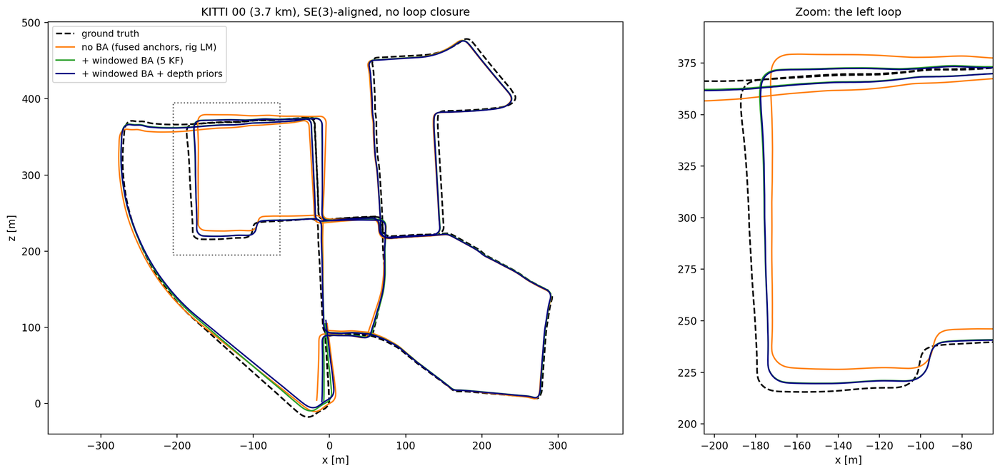

*KITTI 00 (3.7 km, no loop closure). The sparse stereo pipeline with sliding-window bundle adjustment
(green) stays closer to the ground truth than the same pipeline without BA (orange).*

| KITTI 00 + EuRoC MH_01 (full sequences, 0 tracking failures) | KITTI ATE | KITTI t_rel | KITTI r_rel | EuRoC ATE |
|---|---|---|---|---|
| Dense ORB + SGBM stereo depth (baseline) | 8.97 m | 1.73% | 0.79°/100 m | 13.7 cm |
| Sparse FAST/ORB/KLT, fused anchors, rig LM | 10.38 m | 1.39% | 0.50°/100 m | 5.2 cm |
| **+ sliding-window BA (5 keyframes)** | **6.33 m** | **1.18%** | **0.39°/100 m** | **5.1 cm** |
| + BA + gated monocular depth priors | 7.51 m | 1.33% | 0.45°/100 m | 6.5 cm |
| Monocular metric VO (left image + Depth Anything V2) | 116.5 m | 12.6% | 3.36°/100 m | 216.6 cm |

t_rel and r_rel are the official KITTI devkit drift metrics (100-800 m segments); ATE is after SE(3) alignment, without scale.

**The front end.** FAST corners with ORB descriptors are matched only along epipolar lines, refined to
sub-pixel disparity and triangulated with a first-order depth covariance:

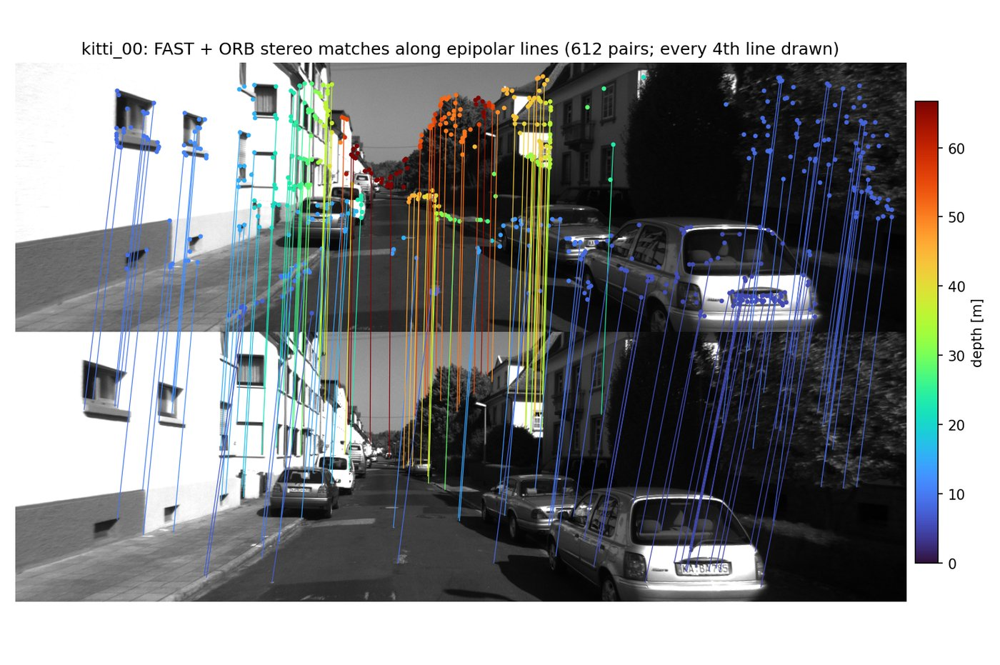

Features are tracked frame to frame with KLT around the circle left(t-1) -> left(t) -> right(t) -> right(t-1).
A track survives only if the circle closes within 1 px, which rejects repetitive texture and moving objects (red):

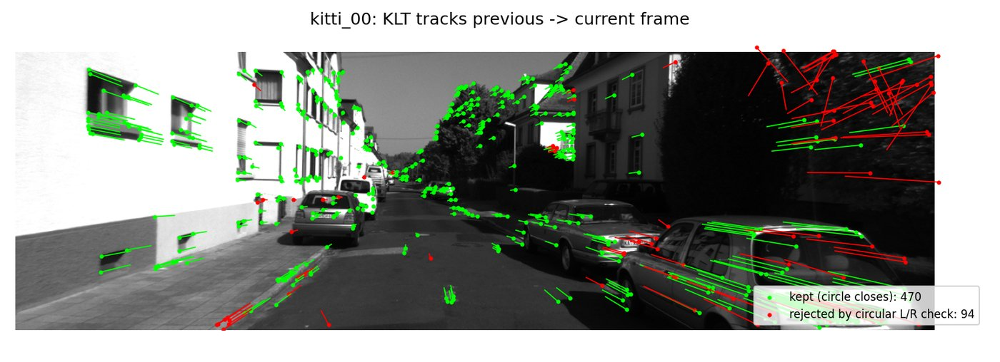

### Hardware: the wheelchair rig

Two Intel RealSense colour cameras (1280×720) are mounted rigidly on a powered wheelchair, about 0.42 m apart,
which is a stereo baseline comparable to KITTI's 0.54 m. The rig is recorded with ROS 2.

<p align="center">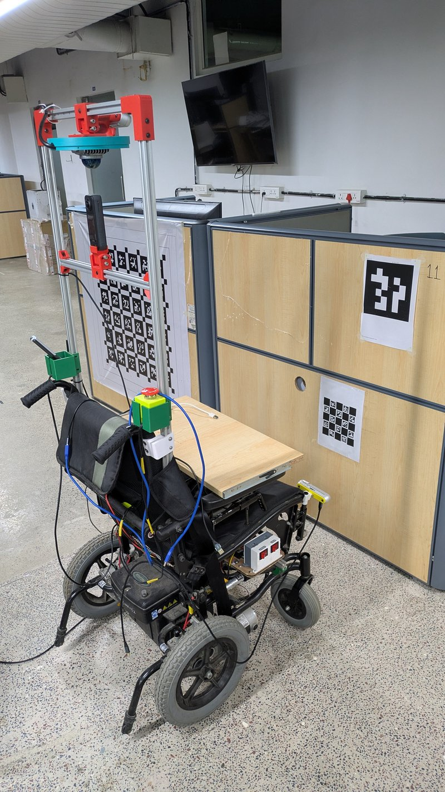<br>
<em>The wheelchair platform: an aluminium mast with 3D-printed mounts, with ChArUco calibration boards on the lab partitions behind.</em></p>

**Stereo calibration.** The extrinsic is calibrated with [MC-Calib](https://github.com/rameau-fr/MC-Calib)
from a ChArUco board (5×5, 3.2 cm squares) seen by both cameras, with the RealSense factory intrinsics held fixed.
Over 245 synchronised frames and 7,558 detected corners, the reprojection error is **0.27 px mean**
(0.32 px RMS, 0.23 px median), under the proposal's 0.5 px target. The calibrated extrinsic is then frozen:
it is the fixed baseline the rigid-rig LM and the windowed BA rely on.


**First 3D data from our own recording.** Both cameras' depth, fused into one frame with the calibrated
extrinsic: 687,980 points from a ROS 2 bag. The wall panel, the ChArUco board and the hole in the panel are all
recovered in 3D, and the two cameras' clouds line up.

<p align="center"></p>

These recordings are now used by parts 1 and 2; the current calibration flow is in [Camera calibration](#camera-calibration-from-mc-calib-to-the-rig-files).

### Datasets

```
~/datasets/euroc/MH_01_easy/mav0/...     # ASL format zip from the EuRoC page, extracted
~/datasets/kitti/sequences/00/...        # KITTI odometry grayscale + calibration
~/datasets/kitti/poses/00.txt            # KITTI ground truth (sequences 00-10)
```

EuRoC images are distorted, so the loader rectifies them with the calibration
in each `sensor.yaml`. EuRoC ground truth describes the IMU body frame. The
pipeline therefore converts camera poses to the body frame before evaluating
and writing trajectories. KITTI images are already rectified, and its ground
truth is in the left camera frame.

### Running experiments

```bash
metricvision list                                              # Show available components
metricvision run configs/synthetic.yaml                        # Smoke test, no download
metricvision run configs/euroc.yaml --dataset-root /data/euroc/MH_01_easy
metricvision run configs/euroc.yaml --dataset-root /data/euroc/MH_01_easy --matcher sift
metricvision run configs/kitti.yaml --dataset-root /data/kitti --max-frames 500
metricvision run configs/kitti.yaml --dataset-root /data/kitti --pipeline sparse --refine lm --run-name sparse_lm
```

`--pipeline {dense,sparse}` picks the VO pipeline, `--refine {none,opencv,lm}` the pose
refinement after PnP + RANSAC, and `--run-name` the output folder (use it for ablations so
runs don't overwrite each other). The full mid-submission matrix (6 runs per sequence) and
the report tables/figures are produced by:

```bash
KITTI_ROOT=/data/kitti EUROC_ROOT=/data/euroc/MH_01_easy JOBS=3 scripts/run_experiments.sh
```

Outside a container, prefix commands with `uv run`. `--matcher` keeps the
shared parameters (`max_keypoints`, `ratio`, `mutual_check`), so the keypoint
budget stays equal when you switch extractors.

Each run writes to `results/<sequence>/<run name>/` (the run name defaults to the front-end name):

| File | Contents |
|---|---|
| `summary.json` | ATE/RPE, tracking failures, mean matches, inlier ratio, runtimes, FPS |
| `frame_stats.csv` | Per-frame matches, inliers, flags and timings (for plots) |
| `trajectory.tum` | Body-frame trajectory, TUM format |
| `trajectory.kitti` | Same trajectory, KITTI format |

To plot with evo (use `--save_plot out.pdf` inside containers without a display):

```bash
evo_ape euroc /data/euroc/MH_01_easy/mav0/state_groundtruth_estimate0/data.csv \
    results/euroc_MH_01_easy/orb/trajectory.tum --align --plot --plot_mode xy
evo_ape kitti /data/kitti/poses/00.txt results/kitti_00/orb/trajectory.kitti --align --plot --plot_mode xz
```

### Reproducing the mid-submission results

Every number and figure in [docs/mid_report.pdf](docs/mid_report.pdf) comes from the commands
below (run from the repository root). On the host, prefix `uv run ...` with `env -u PYTHONPATH`
if ROS 2 is sourced in your shell.

**1. Data (single sequences only, via HTTP range requests):**

```bash
uv run --with remotezip python scripts/download_datasets.py kitti --sequence 00 --out ~/datasets/kitti
uv run --with remotezip python scripts/download_datasets.py euroc --sequence MH_01_easy --out ~/datasets/euroc
```

Any KITTI sequence `00`-`21` (ground truth for `00`-`10`) or EuRoC scene (`MH_0x_*`, `V1_0x_*`,
`V2_0x_*`) works the same way; add `--dry-run` to see the download size first.

**2. Full experiment matrix (18 runs) and report tables/figures:**

```bash
KITTI_ROOT=~/datasets/kitti EUROC_ROOT=~/datasets/euroc/MH_01_easy JOBS=2 scripts/run_experiments.sh
uv run python scripts/make_qualitative_figures.py --out docs/figures \
    --config configs/kitti.yaml:$HOME/datasets/kitti:300 \
    --config configs/euroc.yaml:$HOME/datasets/euroc/MH_01_easy:1200
cd docs && tectonic mid_report.tex     # or: latexmk -pdf mid_report.tex
```

`run_experiments.sh` writes `results/<sequence>/<run>/` and regenerates `docs/tables/*` and
`docs/figures/*` (trajectories, devkit error vs. length, APE vs. distance, runtime, per-frame).

**3. One run on one scene** (the proposed configuration is the default in the configs:
sparse pipeline needs `--pipeline sparse`; `--anchor fused --refine lm` are already the YAML defaults):

```bash
# KITTI sequence 05, proposed method
uv run metricvision run configs/kitti.yaml --dataset-root ~/datasets/kitti --sequence 05 \
    --pipeline sparse --run-name sparse_fused_lm
# EuRoC V1_02_medium (the scene is chosen by its folder)
uv run metricvision run configs/euroc.yaml --dataset-root ~/datasets/euroc/V1_02_medium \
    --pipeline sparse --run-name sparse_fused_lm
# Any row of the results table: pick the pipeline, front end, anchoring and refinement
uv run metricvision run configs/kitti.yaml --dataset-root ~/datasets/kitti \
    --pipeline dense --matcher sift --refine lm --run-name dense_sift_lm
uv run metricvision run configs/kitti.yaml --dataset-root ~/datasets/kitti \
    --pipeline sparse --anchor previous --refine opencv --run-name sparse_f2f_opencv
# Quick check on the first 500 frames
uv run metricvision run configs/kitti.yaml --dataset-root ~/datasets/kitti --max-frames 500 --pipeline sparse
```

| Table row | Flags |
|---|---|
| Dense ORB+SGBM, OpenCV-LM | `--pipeline dense --matcher orb --refine opencv` |
| Dense ORB/SIFT+SGBM, our LM | `--pipeline dense --matcher orb\|sift --refine lm` |
| Sparse f2f, PnP only / OpenCV-LM / rig-LM | `--pipeline sparse --anchor previous --refine none\|opencv\|lm` |
| Sparse birth anchors, rig-LM | `--pipeline sparse --anchor birth --refine lm` |
| Sparse fused anchors, OpenCV-LM / rig-LM (proposed) | `--pipeline sparse --anchor fused --refine opencv\|lm` |

Each run prints its summary and writes `summary.json` (ATE/RPE, failures, timings),
`frame_stats.csv`, `trajectory.tum` and `trajectory.kitti` to `results/<sequence>/<run name>/`.
For the KITTI devkit metric of a single run:

```bash
uv run python -c "from pathlib import Path; from metricvision.evaluation.kitti_metrics import *; \
print(kitti_segment_errors(load_kitti_poses(Path('results/kitti_05/sparse_fused_lm/trajectory.kitti')), \
load_kitti_poses(Path.home() / 'datasets/kitti/poses/05.txt')))"
```

and for plots of a single run, the evo commands in "Running experiments" above.

### Windowed BA and monocular depth priors (POC)

`--window 5` adds a sliding-window rigid-rig bundle adjustment to the sparse pipeline;
`--depth-prior` adds RoMeO-style gated monocular depth priors (Depth Anything V2) to it;
`--pipeline dense --depth depth_anything_v2` runs a left-camera-only monocular metric VO.
The network parts need `uv sync --extra learned` (PyTorch + transformers, < 250 MiB VRAM).
Results, figures and commands: [docs/poc/README.md](docs/poc/README.md) (local; `docs/` is not tracked),
figures regenerated by `scripts/make_poc_figures.py`.

**Bundle adjustment slows drift accumulation.** Orientation and position error against ground truth
from a common start (no alignment fitted), with and without the window BA:


Within a single window BA barely changes keyframe accuracy (it improves in 47% of 496 windows), but it lowers
reprojection error and its refined landmarks feed back into tracking, so drift over the whole sequence drops by 39%.

**Why monocular metric depth needs gating.** Depth Anything V2's metric scale is off, here about 22% too deep:

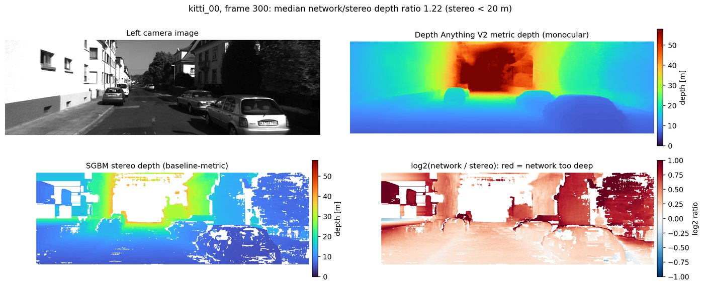

and its scale relative to stereo drifts from keyframe to keyframe (steady 0.82 bias on KITTI, 0.67-1.66 on EuRoC):


So each keyframe's network depth is first aligned to the stereo scale. A prior is then kept only for weakly
triangulated landmarks where it agrees with stereo (green). Precise stereo landmarks need none (grey),
and inconsistent priors are rejected (red):

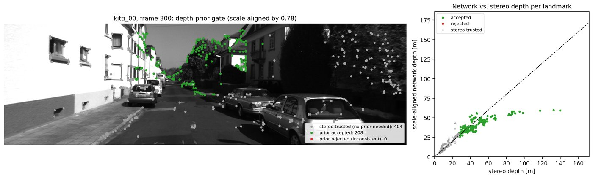

On a 0.54 m baseline the priors don't yet beat BA alone (7.5 vs 6.3 m ATE). They should matter more where
stereo is weak: low texture, distant scenes, or a short baseline.

Quick check of the network on its own (scale vs stereo, error, runtime, GPU memory):

```bash
uv run python scripts/check_mono_depth.py --config configs/kitti.yaml --dataset-root ~/datasets/kitti --frames 20
```

### Final phase: GTSAM BA, loop closure and hybrid learned VO (KITTI 00)

Results of the final-phase experiments (Nov 2026). **Code status:** the GTSAM window BA (`backend/ba.py`), loop
closure (`backend/loop_closure.py`, DINOv2 / thumbnail place recognition + GTSAM pose graph) and confidence
weighting live in commit `f3a98c4` and are **not on this branch**: that commit replaces the window BA and the
Depth Anything V2 prior above, which are still in use. The SuperPoint+LightGlue front end from it is on this
branch (`--stereo-frontend superpoint_lightglue`, the "learned" approach of parts 1 and 2).

| method (KITTI 00, 4541 frames, 3.7 km) | ATE RMSE [m] | ATE max [m] | t_rel [%] | r_rel [°/100 m] | RPE 1-frame [m] | loops | FPS |
|---|---|---|---|---|---|---|---|
| classical VO (mid-submission method) | 10.30 | 21.11 | 1.38 | 0.49 | 0.03 | 0 | 11.1 |
| + window BA | 5.55 | 10.14 | 1.16 | 0.38 | 0.07 | 0 | 6.6 |
| + BA + loop closure (thumbnail) | 1.79 | 3.70 | 0.86 | 0.31 | 0.08 | 32 | 5.6 |
| + BA + loop closure (DINOv2) | 1.86 | 4.03 | 0.89 | 0.31 | 0.12 | 37 | 8.7 |
| SuperPoint+LightGlue VO (KLT sub-pixel) | 14.05 | 29.43 | 1.65 | 0.60 | 0.03 | 0 | 6.7 |
| + confidence weighting | 14.08 | 29.56 | 1.65 | 0.60 | 0.03 | 0 | 8.0 |
| **full hybrid: SP+LG + BA + DINOv2 loop** | **1.73** | **3.47** | 0.90 | 0.37 | 0.17 | 36 | 6.2 |

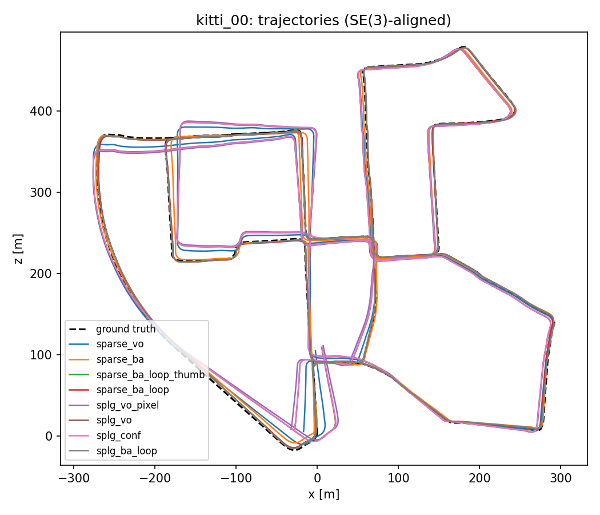

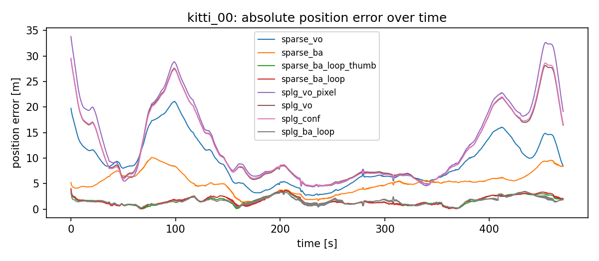

Old (mid-submission) vs new, step by step:

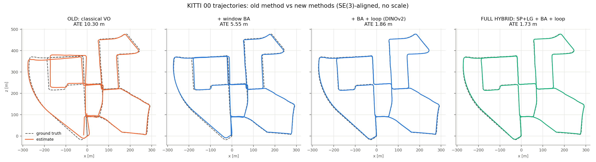

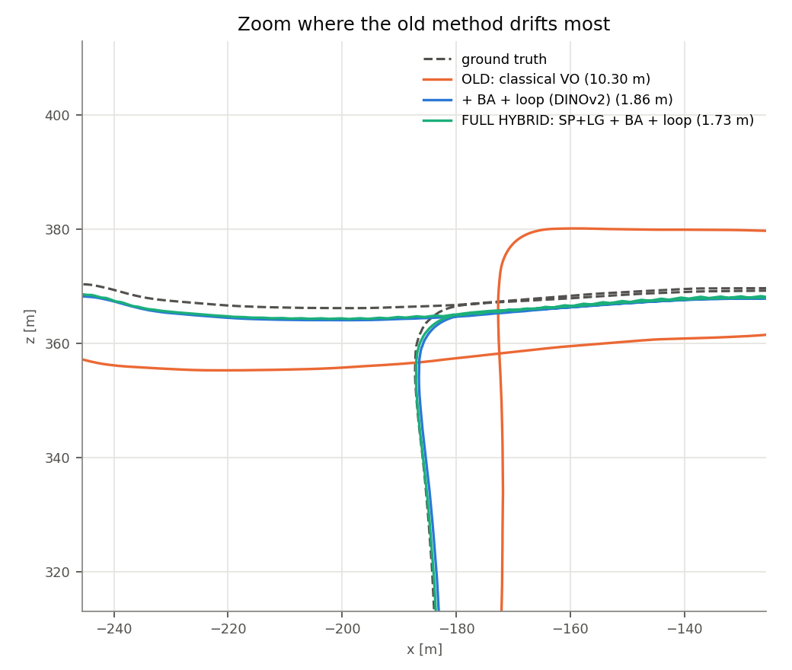

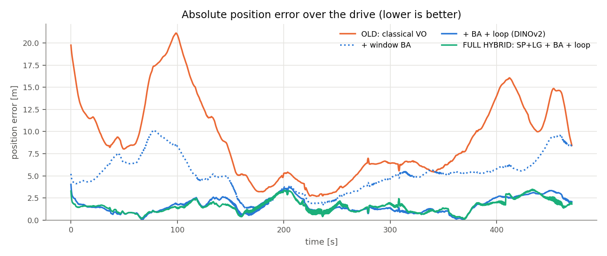

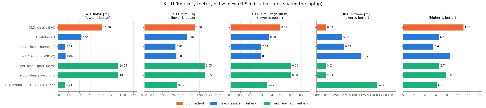

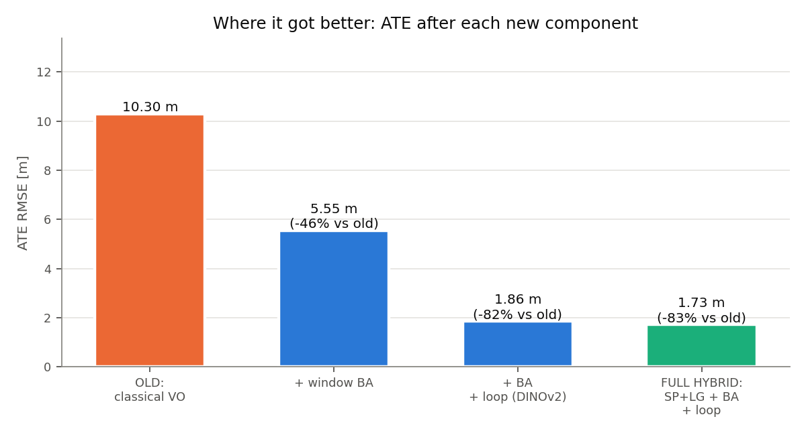

Findings: BA halves the drift and loop closure removes most of what is left (ATE -83 %). On KITTI's
well-textured, well-lit images the learned front end is *less* accurate than FAST/ORB + KLT, and confidence
weighting changes nothing (LightGlue is confident on nearly every match there). BA and loop closure raise the
1-frame RPE: corrections are blended between keyframes, so global accuracy improves at some cost in local smoothness.

**Robustness under simulated hard conditions** (KITTI 00 images degraded; same rig PnP + LM for both front ends):

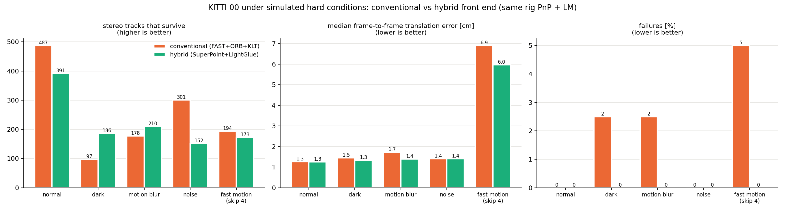

| condition | front end | stereo tracks | median t err [cm] | median r err [°] | failures [%] |
|---|---|---|---|---|---|
| normal | conventional (FAST+ORB+KLT) | 487 | 1.3 | 0.032 | 0 |
| normal | hybrid (SuperPoint+LightGlue) | 391 | 1.3 | 0.029 | 0 |
| dark | conventional | 97 | 1.5 | 0.034 | 2 |
| dark | hybrid | 186 | 1.3 | 0.033 | 0 |
| motion blur | conventional | 178 | 1.7 | 0.041 | 2 |
| motion blur | hybrid | 210 | 1.4 | 0.030 | 0 |
| noise | conventional | 301 | 1.4 | 0.038 | 0 |
| noise | hybrid | 152 | 1.4 | 0.031 | 0 |
| fast motion (skip 4) | conventional | 194 | 6.9 | 0.062 | 5 |
| fast motion (skip 4) | hybrid | 173 | 6.0 | 0.067 | 0 |

The learned front end keeps more tracks in the dark and under blur and never loses tracking, where the classical
one fails on 2-5 % of frames. Matches per condition:

| normal | dark | motion blur |
|---|---|---|
| 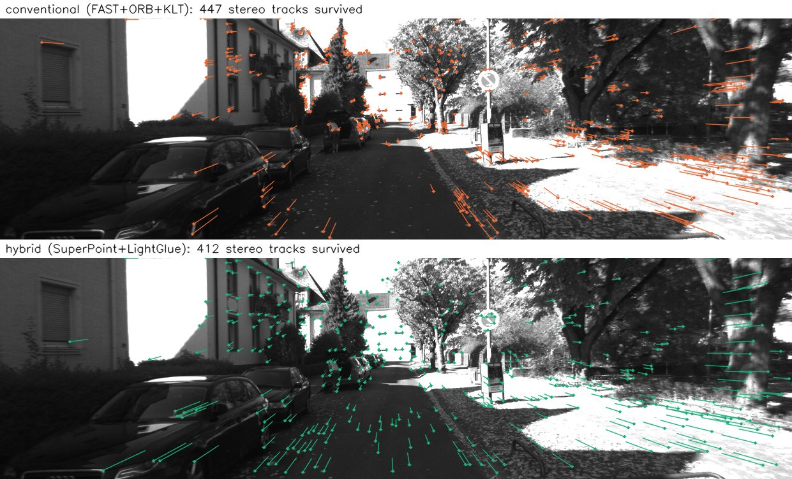 | 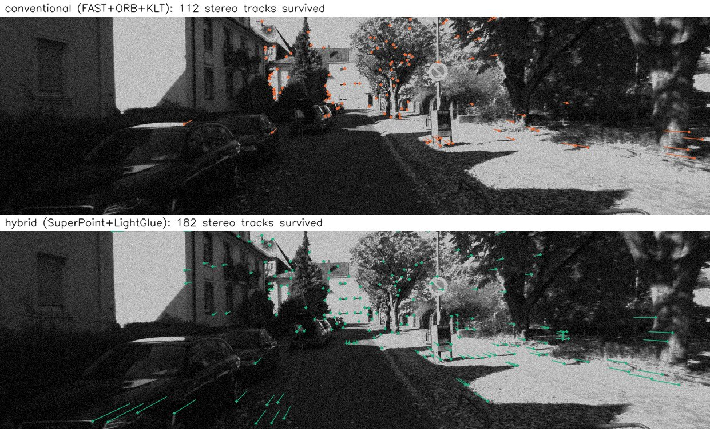 | 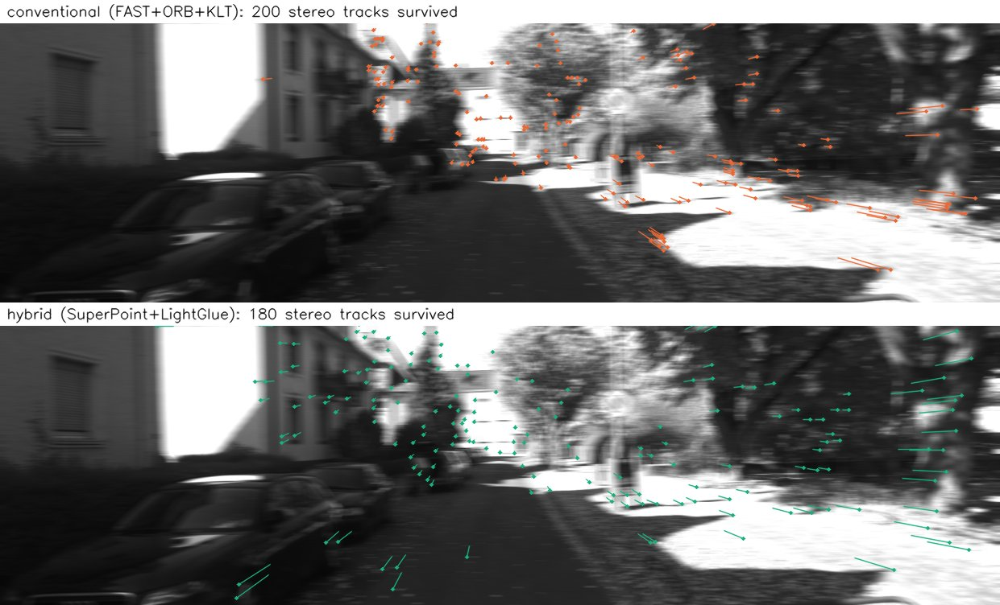 |

| noise | fast motion |
|---|---|
| 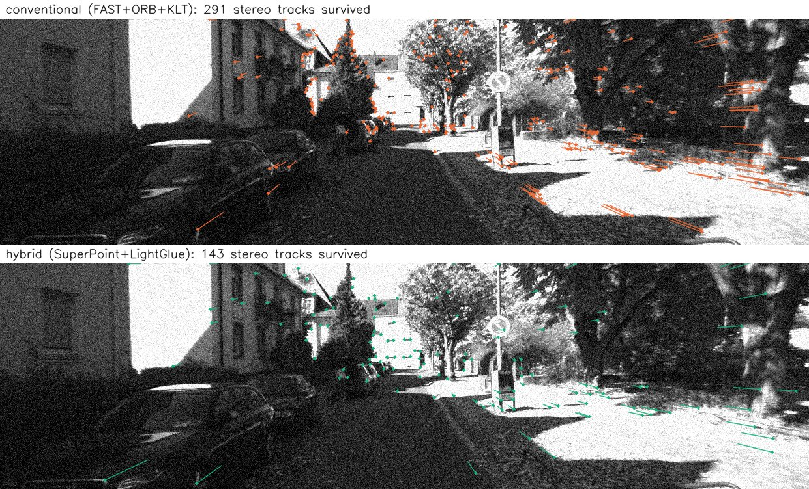 | 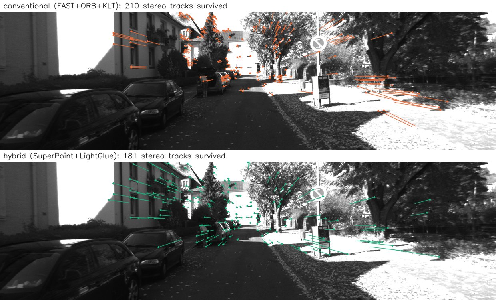 |

### Jetson dev container

The laptop container (`.devcontainer/laptop/`) is the one used for parts 1 and 2. For the Jetson AGX Orin:

1. On the Jetson, run `cat /etc/nv_tegra_release`. Set `L4T_TAG` in
   `.devcontainer/jetson/devcontainer.json` to match (e.g. `R36 … REVISION: 4.0` → `r36.4.0`).
2. From the laptop, use **Remote-SSH** to connect to the Jetson and open the cloned repo.
3. Run **Reopen in Container** and choose **metricvision (Jetson AGX)**.
4. Run the synthetic smoke test. It exercises the entire pipeline without any data.
Both images use Ubuntu 22.04 with its system Python 3.10 and the same
`uv.lock`, so the environment is identical on both machines. Adding ROS 2
Humble's `rclpy` later works because it is built for that same Python.

### Learned front ends: SuperPoint, ALIKED, MASt3R

Three learned front ends plug into the same pairwise `FeatureMatcher` interface as ORB and SIFT. They run under
the identical dense back end (keyframe matching, SGBM depth, PnP + our LM, same thresholds), at native image
resolution with the same 2000-keypoint budget:

| `--matcher` | Method | Notes |
|---|---|---|
| `superpoint_lightglue` | SuperPoint + LightGlue (official cvg/LightGlue) | ~0.4 GB VRAM; weights download on first use |
| `aliked_lightglue` | ALIKED + LightGlue | ~0.8 GB VRAM |
| `mast3r` | MASt3R dense matcher (2D matches only, never its 3D output) | ~2.8 GB VRAM, ~6 GB host RAM while loading; non-commercial licence |

```bash
uv sync --all-groups --extra learned
# MASt3R only: clone the research code and fetch the checkpoint (~2.75 GB)
git clone --recursive https://github.com/naver/mast3r.git third_party/mast3r
D=third_party/mast3r/checkpoints/MASt3R_ViTLarge_BaseDecoder_512_catmlpdpt_metric; mkdir -p $D
B=https://huggingface.co/naver/MASt3R_ViTLarge_BaseDecoder_512_catmlpdpt_metric/resolve/main
curl -L -o $D/config.json $B/config.json && curl -L -C - -o $D/model.safetensors $B/model.safetensors
# Run any of them
uv run metricvision run configs/kitti.yaml --dataset-root ~/datasets/kitti --pipeline dense --matcher aliked_lightglue --refine lm --run-name dense_aliked_lg_lm
```

**The same KITTI pair, matched by every front end** (green: consistent with one essential matrix at 1 px; red: outliers):

<p align="center">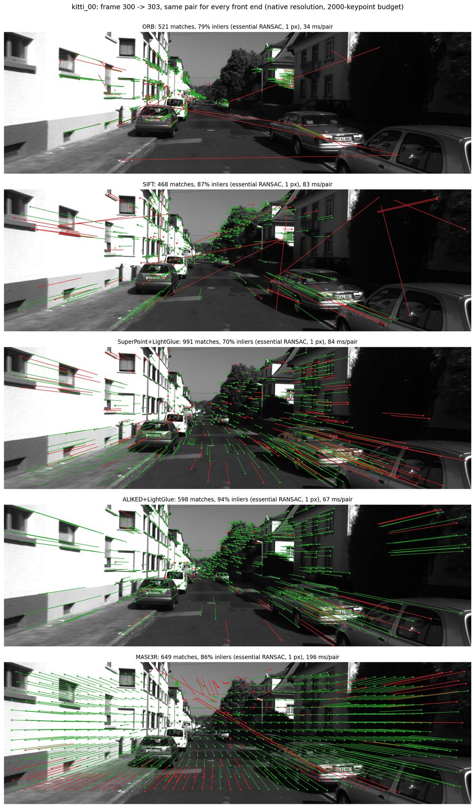</p>

**Full-sequence results under one back end** (KITTI 00, 4541 frames; EuRoC MH_01, 3682 frames; 0 tracking failures in every run):

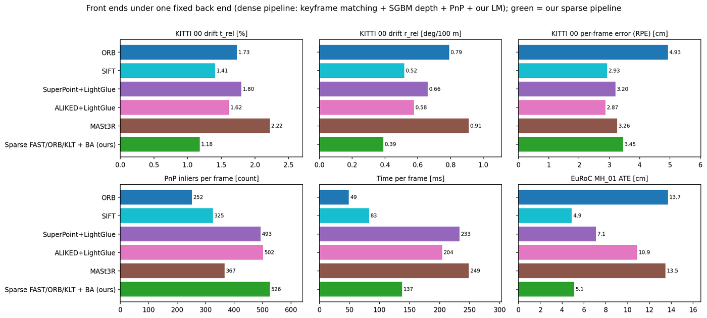

| Front end (dense pipeline, our LM) | KITTI t_rel | KITTI r_rel | KITTI RPE | Inliers | ms/frame | EuRoC ATE |
|---|---|---|---|---|---|---|
| ORB | 1.73% | 0.79°/100 m | 4.9 cm | 252 | 49 | 13.7 cm |
| SIFT | 1.41% | 0.52°/100 m | 2.9 cm | 325 | 83 | 4.9 cm |
| SuperPoint + LightGlue | 1.80% | 0.66°/100 m | 3.2 cm | 493 | 233 | 7.1 cm |
| ALIKED + LightGlue | 1.62% | 0.58°/100 m | 2.9 cm | 502 | 204 | 10.9 cm |
| MASt3R | 2.22% | 0.91°/100 m | 3.3 cm | 367 | 249 | 13.5 cm |
| *Sparse FAST/ORB/KLT + windowed BA (ours)* | **1.18%** | **0.39°/100 m** | 3.5 cm | 526 | 137 | 5.1 cm |

What this shows:
* **More matches do not mean less drift.** The LightGlue front ends find about 2x ORB's inliers and lower per-frame
  error, but their long-range drift is no better than SIFT's. In a fixed metric back end, drift is set by depth
  quality and pose estimation as much as by matching.
* **MASt3R is robust but imprecise here.** It matches a 512x160 version of the image, so each match is only
  accurate to about ±1.2 px at KITTI's native resolution, and its drift is the highest. Its strength is coverage:
  it matches textureless road and sky that keypoint detectors ignore.
* The learned front ends are 4-5x slower than ORB on a laptop RTX 3060 (timings measured with two runs in parallel).
  The sparse pipeline with windowed BA remains the most accurate configuration.

### Dynamic scenes: moving objects and occlusions

Two complementary, optional layers handle moving objects and occlusions:

* **Geometric gate** (`--dynamic-gate`, sparse pipeline, no network). Before a new stereo observation is fused
  into a track's landmark, a 3σ Mahalanobis test checks it against the landmark's covariance. Points on moving
  objects, or tracks that jumped onto an occluder, fail and are dropped. It is class-agnostic and free.
* **Semantic mask** (`--dynamic-mask`, both pipelines). SegFormer-B0 trained on Cityscapes (~170 MiB VRAM, ~14 ms)
  masks people, riders, cars, trucks, buses and bikes. No features are detected or tracked there, and matches
  landing on them are dropped.

Evaluated on KITTI 00 and on **KITTI 07** (busy streets and intersections):

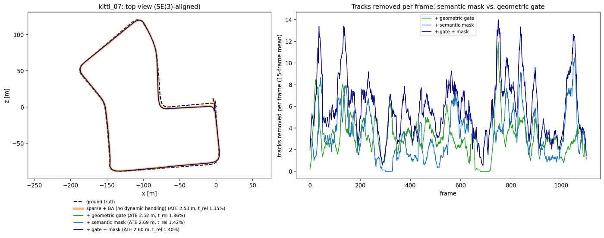

| | KITTI 00 ATE | KITTI 07 ATE | KITTI 07 t_rel | Removed per frame |
|---|---|---|---|---|
| Dense ORB | 8.97 m | 4.60 m | 2.40% | – |
| Dense ORB + semantic mask | 22.16 m | 5.99 m | 2.74% | ~150 matches |
| Sparse + windowed BA | 6.33 m | 2.53 m | 1.35% | – |
| + geometric gate | 6.76 m | 2.52 m | 1.36% | ~3 tracks |
| + semantic mask | 6.26 m | 2.69 m | 1.42% | ~3.5 tracks |
| + gate + mask | 6.25 m | 2.60 m | 1.40% | ~6 tracks |

What this shows:
* **On KITTI, class-based masking hurts.** Most cars are parked: they are close, textured and static, which makes
  them some of the best metric features. Masking them removes ~150 matches per frame from the dense pipeline,
  and drift rises.
* **The sparse pipeline already rejects movers.** Its circular L/R check, RANSAC and the LM's χ² test remove almost
  everything that moves, so the gate and the mask find only 3-6 more tracks per frame. The changes stay within
  about ±0.4 m.
* A fair test needs genuinely dynamic sequences: dense traffic, crowds, or synthetic data with moving objects such
  as Virtual KITTI 2. KITTI 07's moving vehicles are a small fraction of its features.

### Design decisions

**The front end is pairwise.** `FeatureMatcher.match(view_a, view_b)` returns
2D-2D correspondences. Sparse methods implement it through
`SparseFeatureMatcher`, which caches each image's features by frame id, so a
keyframe is processed once. Dense matchers such as MASt3R have no persistent
keypoints and will implement `match` directly. Both plug into the same back end.

**Depth comes from fixed SGBM.** The extractor only affects keyframe-to-frame
matching and is never used for stereo matching. So each extractor is measured
in exactly one place.

**Tracking failure is defined explicitly.** A failure is PnP with fewer than
`pnp.min_inliers` inliers. On failure, the pose coasts on a constant-velocity
prediction, the frame becomes a new keyframe, and the failure is counted. A
pose is written for every frame, so KITTI-format files always align with
ground truth line by line.

**Runtime is measured honestly.** Front-end, pose and depth times are recorded
separately. `FeatureMatcher.synchronize()` is called before stopping the
front-end timer, and GPU matchers must override it with
`torch.cuda.synchronize()`. The essential-matrix inlier ratio is computed
after the timer stops, because it is a measurement, not part of the pipeline.

**Inlier ratio is front-end-only.** It comes from 2D-2D essential-matrix
RANSAC on the raw matches, independent of depth and PnP. It is optimistic
when the camera barely moves, so read it together with the trajectory error.

**Loop closure is deliberately absent,** so front-end drift stays visible.

**Keep these equal across extractors for fairness:** image resolution,
`max_keypoints`, ratio test settings, every `pnp.*` and `keyframe.*`
threshold, and the SGBM settings.

**The sparse pipeline tracks 2D features frame to frame, but anchors 3D points per track.** Each stereo pair is tracked
prev-left -> cur-left -> cur-right -> prev-right with KLT and kept only if the circle
closes within `circular_tolerance_px` and the new pair satisfies the epipolar constraint.
KLT is seeded by projecting the triangulated points with the constant-velocity prediction.
Only LM inliers stay tracked; FAST/ORB stereo detection tops up the grid when tracks fall
below `replenish_fraction * max_features` (these frames are counted as "keyframes").
`odometry.sparse_point_anchor` (or `--anchor`) selects the 3D points PnP/LM use:
`previous` re-triangulates in the previous frame (pure frame-to-frame, accumulates small biases),
`birth` keeps each track's first world-frame point, and `fused` (default) fuses every new stereo
triangulation into it by inverse covariance, so far points sharpen as they are re-observed.

**The LM is the rigid-rig estimator.** `backend/lm.py` minimises Huber-robustified,
covariance-whitened stereo reprojection error `(u_l, v_l, u_r)` over a left-multiplied
SE(3) update, with analytic Jacobians `[I | -[p]x]` and the pinhole projection Jacobian
(the right row `v_r` is left out: in a rectified rig it carries no depth and only imports rectification error).
Each residual is whitened by `J_X Sigma_X J_X^T + sigma^2 I`, where `Sigma_X` is the
triangulation covariance, so distant points (sigma_Z ~ Z^2) are down-weighted. The tests
check the Jacobians against finite differences and the covariance against Monte Carlo.

## Troubleshooting

| Symptom | Fix |
|---|---|
| `images left 0 right 0` | `echo $ROS_DOMAIN_ID` must match the wheelchair (7) |
| rviz2 freezes / windows close | laptop out of memory: close browsers; use `approaches:=classical`, `rviz:=false` |
| `TRACKING FAILING` in the log | read the hint; check `/vo/debug_image` |
| first learned run is slow to start | SuperPoint/LightGlue weights download once (cached in Docker volumes) |

## Layout

```
ros2_ws/src/metricvision_ros/    ROS 2 package: launch/vo.launch.py, config/vo_params.yaml, rviz/vo.rviz
src/metricvision/ros/            vo_node.py (live VO, both approaches, saving, /vo/save), vo_plot.py (graph window)
src/metricvision/                VO library: frontend/ (classical, learned), backend/ (rigid-rig LM, window BA),
                                 calibration/ (stereo self-calibration), datasets/ (rosbag, KITTI, EuRoC, synthetic),
                                 depth/ (SGBM, Depth Anything V2), evaluation/ (metrics, live report), viz/, cli.py
scripts/                         run_simulation.sh, simulation_report.py, compare_live.py, visualize_vo.py,
                                 calibrate_rig_from_bags.py, estimate_camera_to_base.py, download_datasets.py
                                 part 3: run_experiments.sh, make_report_assets.py, make_qualitative_figures.py,
                                 make_poc_figures.py, check_mono_depth.py
configs/                         wheelchair.yaml (+ wheelchair/: rig_640x480.yaml bags, rig_640x480_live.yaml live),
                                 kitti.yaml, euroc.yaml, synthetic.yaml
.devcontainer/laptop/            CUDA + ROS 2 Humble image (both parts)
.devcontainer/jetson/            Jetson AGX Orin (L4T / JetPack 6) image
assets/readme/                   README figures
```

Development: `uv run pytest`, `uv run ruff check src tests scripts`, `uv run mypy src/metricvision`.
